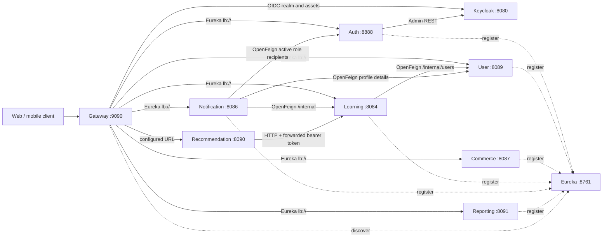
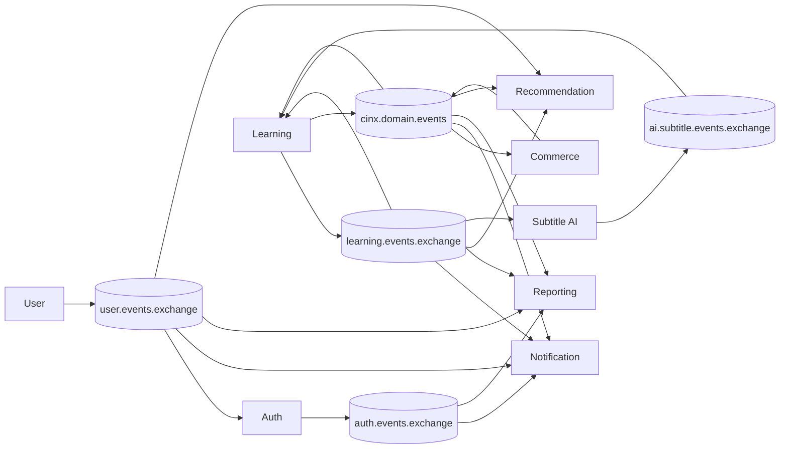

# CINX Interaction Map

This document is the human-readable companion to
[`service-catalog.yaml`](./service-catalog.yaml). The YAML catalog is the
machine-readable inventory; runtime code and contracts remain authoritative
when the two disagree.

## Request topology

The gateway rejects `/internal/**`. Current Java service security permits those
paths locally, so network isolation is part of the trust boundary; do not add an
internal route to the gateway.

## Data ownership

| Owner | Database | Primary responsibility |
|---|---|---|
| Keycloak | `keycloakdb` | Credentials, OIDC clients, roles, sessions |
| Auth | `authdb` | Identity mapping, account status/role synchronization |
| User | `userdb` | Profiles, instructor onboarding, policy documents |
| Commerce | `commercedb` | Cart, wishlist, order, voucher, payment, catalog, subscriptions, entitlement authority |
| Learning | `learningdb` | Catalog, access policy/grants, entitlement projection, progress, assessment, community, certificates |
| Notification | `notificationdb` | Notifications, delivery state, device tokens, non-authoritative entitlement projection |
| Reporting | `reportingdb` | Event-fed account, order, enrollment and entitlement projections |
| Recommendation | `recommendationdb` | Recommendation projections, entitlement/quota projection, interactions, knowledge, agent sessions |
| Subtitle AI | none | Stateless subtitle worker; files live in object storage |

Services must not read another service's database. Use an existing internal API
for request-time data or an event-fed local projection for durable decoupling.

## Event topology

Auth, User, Commerce, and Learning persist domain changes and outbox records in
the same transaction, then relay them to RabbitMQ. Consumers that own inboxes
must record idempotency and mutate their projection in the same transaction.
Subtitle AI publishes directly with bounded retry because it has no database.

Commerce publishes the full `commerce.subscription.entitlements.changed`
snapshot through its transactional outbox. Learning and Recommendation use the
local projection for access/quota hot paths; Notification and Reporting retain
it only for communication/analytics and never as billing authority.

## Current verification gap

Recommendation and Subtitle AI remain intentionally outside Docker Compose and
service CI. Both have local unit-test commands in the service catalog, so run
them explicitly whenever their event contracts or worker behavior changes.

Treat these as defects, not alternative contracts. If a fix changes a routing
key or endpoint, update the producer/caller, every consumer/target, AsyncAPI (or
OpenAPI), tests, and `service-catalog.yaml` together.

## Change-impact checklist

Before changing a public endpoint, internal endpoint, event, or database model:

1. Find the owner in `service-catalog.yaml`.
2. Search the whole repository for the path, exchange, routing key, DTO, and
   event type.
3. Name all affected callers, producers, and consumers in the PR description.
4. Add a new Flyway migration; never edit an already-applied migration.
5. Run the module verification command and the affected consumer/caller tests.
6. Update this map only when the interaction topology changes.
