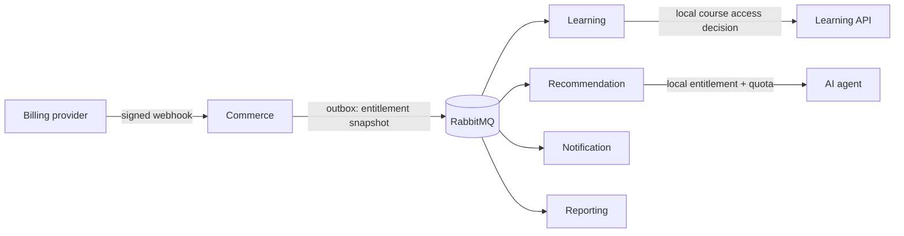

# Plans, subscriptions, entitlements and quotas

Status: implemented local-unit baseline; paid billing disabled and production stabilization deferred

The repository now contains the Phase C-F migrations, provider-neutral APIs,
Stripe sandbox adapter, entitlement snapshot contract and consumer projections.
`cinx.subscription.billing-enabled` remains `false`; live Stripe, tax/refund,
merchant-country, canary and integration verification stay deferred.

Last reviewed: 2026-08-02

Owners: commerce for commercial truth; each consuming service for local
enforcement and usage

## 1. Purpose

This document defines an implementable v1 model for:

- a public plan catalog and immutable plan versions;
- individual recurring subscriptions;
- effective feature entitlements;
- subscription-aware course access;
- local quota accounting for metered features;
- provider-independent billing integration;
- durable propagation to learning, recommendation, notification and reporting.

It complements the
[authentication and authorization design](../security/authentication-authorization.md)
and the
[authorization matrix](../security/authorization-matrix.yaml).

The design is now backed by a local-unit implementation. Legacy one-time
checkout and `isInSubscription` remain only for compatibility/backfill; the
Commerce subscription aggregate, entitlement projections and recommendation
quota ledger are the runtime seams for the new flow. Live provider and
infrastructure verification remains deferred.

## 2. Decisions and v1 assumptions

The following product and architecture decisions are now the v1 baseline:

1. A plan is a commercial product, never an identity role, permission or JWT
   authority. Buying, renewing, canceling or administratively adjusting a plan
   MUST NOT grant or revoke `ROLE_*`, `PERM_*` or `SCOPE_*`.
2. V1 enables only individual `USER` subscription subjects. The aggregate uses
   a subject identifier now so organization billing can be added later without
   rewriting every subscription primary/foreign key; seats and organization
   beneficiaries remain out of v1.
3. Plans are grouped into product lines and customer segments. The initial
   lines are `LEARNING`/`LEARNER` and `CREATOR`/`INSTRUCTOR`.
4. Every v1 plan uses the single `BASE` subscription slot, so a user has at most
   one current base plan. An instructor may buy a learner plan or switch to an
   instructor plan, but cannot hold both base plans concurrently in v1.
5. Every onboarded user receives the target of the data-managed
   `DEFAULT_USER_BASE` binding (the illustrative target is `LEARNER_FREE`).
   Becoming an instructor makes creator plans eligible; it does not
   automatically buy or switch a plan.
6. Instructor plans explicitly contain every learner feature they retain; they
   do not inherit commercial grants from an authorization role or plan family.
   The illustrative `INSTRUCTOR_FREE` is a selectable zero-price creator base
   plan for a verified instructor, not an onboarding fallback; selecting it is
   an explicit normal plan-change command with no provider Checkout call.
7. Subscription supports both selected course-catalog access and platform/AI
   features while permanent course purchase remains available.
8. Paid plans support monthly and yearly recurring prices. Catalog, copy,
   offers, prices, billing-policy references, entitlements and quota values are
   managed as versioned commerce data rather than application constants.
9. A published plan version is immutable.
10. Upgrade takes effect only after verified provider payment confirmation.
    Downgrade and self-service cancellation take effect at period end.
11. Quotas are hard limits, reset on the feature's declared UTC period and do
    not allow overage or unused-unit rollover in v1. The sample paid quotas use
    `CALENDAR_MONTH`, so a yearly price does not accidentally turn a monthly
    allowance into an annual allowance.
12. The launch billing policy has no trial and a suggested 72-hour
    renewal-failure grace period. A card-required, one-time seven-day trial is
    modeled as a disabled example policy that can be enabled without code
    changes after product and abuse review.
13. Stripe-hosted Checkout is the preferred SPA integration for market `VN`
    and presentment currency `VND`, behind the provider port described below.
14. Commerce publishes a full effective-entitlement snapshot. Consumers
    enforce from a local projection and do not call commerce on every request.

Learning therefore retains permanent purchases and allows authorized platform
staff to mark selected courses as subscription-accessible. Core instructor
capabilities continue to require the pre-existing `INSTRUCTOR` role/permissions
and must not be paywalled accidentally; paid plans gate only documented premium
features and quotas.

The illustrative catalog and suggested prices are in
[`plan-catalog-example.yaml`](./plan-catalog-example.yaml). It is disabled
example input, not a production seed or runtime source of truth.

## 3. Ownership and boundaries

| Concern | Authoritative owner | Projections/consumers |
|---|---|---|
| Plan identity, versions, price references | commerce | public API, reporting |
| Subscription and billing lifecycle | commerce | learning, recommendation, notification, reporting |
| Effective feature snapshot | commerce | local feature projections |
| Course publication and access policy | learning | commerce/recommendation projection as required |
| Permanent course-access grant | learning | reporting if needed |
| Enrollment and progress | learning | reporting |
| Feature usage and quota reservation | service executing the feature | reporting via events |
| Credentials, roles and permissions | auth/Keycloak boundary | all resource services |

Rules:

- No service reads commerce tables directly.
- Commerce does not write learning entitlements or progress.
- Learning does not infer billing state from a browser redirect.
- A JWT does not carry authoritative plan, subscription, quota or usage data.
- Internal HTTP is for reconciliation and support, not the normal
  authorization hot path.



## 4. Stable feature registry

Before plans are implemented, add a version-controlled registry such as:

```text
contracts/entitlements/cinx-features.yaml
```

The registry defines each stable key, owner, value type, metering unit,
allowed reset policy, composition rule and whether a value can be exposed
publicly. Composition is defined now even though v1 enables one `BASE` slot:
future add-ons or organization grants must not invent merge behavior at
runtime.

Initial keys:

| Feature key | Owner/enforcer | Type | Meaning |
|---|---|---|---|
| `learning.subscription-catalog.access` | learning | boolean | Access to courses whose policy accepts this feature |
| `learning.subscription-catalog.extended` | learning | boolean | Access to the separately curated extended catalog |
| `learning.offline-download` | learning | boolean | Offline/download capability |
| `learning.instructor.analytics.advanced` | learning | boolean | Premium instructor analytics |
| `learning.instructor.bulk-tools` | learning | boolean | Premium bulk authoring/management tools |
| `learning.instructor.subtitle.minutes` | learning | quota | AI subtitle processing minutes per declared period |
| `recommendation.agent.advanced` | recommendation | boolean | Advanced learning assistant |
| `recommendation.agent.requests` | recommendation | quota | Number of agent requests in a quota period |
| `recommendation.instructor.authoring.requests` | recommendation | quota | Instructor authoring-assistant requests per period |

Feature keys:

- MUST be lowercase dot-separated identifiers;
- MUST NOT contain a plan name such as `pro` or `gold`;
- MUST remain semantically stable after publication;
- are deprecated by adding a replacement key, not by changing meaning;
- MUST identify a single enforcing service;
- MUST declare a deterministic composition rule: normally `ANY_TRUE` for
  boolean grants and `MAX` for quota limits; `SUM` requires an explicit product
  decision because it changes financial exposure.

A plan grants feature values; application code asks about a feature key. Code
does not branch on `planCode`, product line or customer segment. A feature may
still require a security permission, resource relationship and state check;
commercial entitlement never creates that security capability.

## 5. Commerce persistence model

Names below are logical. Follow the bounded context's normal naming and
auditing conventions during implementation.

### 5.1 Plan catalog

```text
plan_product_line
  id PK
  code UNIQUE                  LEARNING | CREATOR
  customer_segment            LEARNER | INSTRUCTOR
  eligibility_policy_key      ACTIVE_LEARNER | VERIFIED_INSTRUCTOR
  subscription_slot_code      BASE
  display_order
  status                      ACTIVE | RETIRED
  created_at
  updated_at

subscription_plan
  id PK
  product_line_id FK
  code UNIQUE
  lifecycle_status          DRAFT | ACTIVE | RETIRED
  created_at
  updated_at

subscription_plan_version
  id PK
  plan_id FK
  billing_policy_version_id FK
  version_number
  publication_status        DRAFT | PUBLISHED | SUPERSEDED
  default_locale
  effective_from
  published_at
  published_by
  UNIQUE(plan_id, version_number)

plan_version_translation
  plan_version_id FK
  locale                      vi-VN | en
  display_name
  description
  badge nullable
  PRIMARY KEY(plan_version_id, locale)

billing_policy_version
  id PK
  code
  version_number
  publication_status          DRAFT | PUBLISHED | SUPERSEDED
  trial_enabled
  trial_duration_days nullable
  payment_method_required
  maximum_trial_redemptions nullable
  trial_redemption_scope nullable  SUBJECT_PRODUCT_LINE
  renewal_failure_policy
  grace_duration_seconds
  access_during_grace
  quota_during_grace_policy       DENY_METERED | PRESERVE_REMAINING | GRANT_LIMIT
  quota_rollover_enabled
  quota_overage_enabled
  upgrade_effective_policy
  upgrade_proration_policy
  upgrade_pending_update_required
  downgrade_effective_policy
  cancellation_effective_policy
  eligibility_loss_access_policy  IMMEDIATE_INELIGIBLE
  eligibility_loss_provider_policy CANCEL_AT_PERIOD_END | CANCEL_IMMEDIATELY
  eligibility_loss_refund_policy  NONE | PRORATED | MANUAL_REVIEW
  published_at
  UNIQUE(code, version_number)

plan_provider_product
  id PK
  plan_id FK
  provider
  provider_account_key            logical config key, never a secret
  provider_product_ref
  provider_lookup_key
  status                          ACTIVE | INACTIVE
  UNIQUE(plan_id, provider, provider_account_key)
  UNIQUE(provider, provider_account_key, provider_product_ref)

plan_price
  id PK
  plan_id FK
  provider_product_id FK
  market_code                 ISO-3166-1 alpha-2, initially VN
  currency                  ISO-4217 uppercase
  billing_interval          MONTH | YEAR
  interval_count
  amount                    DECIMAL(19,2)
  provider
  provider_account_key        logical config key, never a secret
  provider_price_ref
  provider_lookup_key
  tax_behavior                INCLUSIVE | EXCLUSIVE | UNSPECIFIED
  status                    ACTIVE | INACTIVE
  UNIQUE(id, plan_id)
  UNIQUE(provider, provider_account_key, provider_price_ref)
  UNIQUE(provider, provider_account_key, provider_lookup_key)

plan_offer
  id PK                       opaque ID accepted from the SPA
  plan_version_id FK
  plan_id FK                   validates price belongs to the version's plan
  price_id nullable FK        null only for an internal free plan
  market_code
  sales_start nullable
  sales_end nullable
  display_order
  status                      ACTIVE | INACTIVE
  UNIQUE(plan_version_id, market_code, display_order)
  FK(plan_version_id, plan_id) -> subscription_plan_version(id, plan_id)
  FK(price_id, plan_id) -> plan_price(id, plan_id)

plan_system_binding
  id PK
  binding_key                  DEFAULT_USER_BASE | <reviewed future key>
  subject_type                 USER in v1
  source_product_line_id nullable
  subscription_slot_code       BASE in v1
  market_code
  target_plan_version_id FK
  effective_from
  effective_until nullable
  status                       ACTIVE | INACTIVE
  UNIQUE(binding_key, subject_type, source_product_line_id, subscription_slot_code, market_code, effective_from)

plan_entitlement
  id PK
  plan_version_id FK
  feature_key
  grant_type                BOOLEAN | QUOTA
  boolean_value nullable
  quota_limit nullable
  quota_unlimited nullable
  quota_unit nullable
  reset_policy nullable      SUBSCRIPTION_PERIOD | CALENDAR_MONTH
  configuration_json nullable
  UNIQUE(plan_version_id, feature_key)

plan_publication_job
  id PK
  plan_version_id FK
  command_id UNIQUE
  status                      PENDING | RUNNING | RETRYABLE_FAILED | SUCCEEDED | DEAD
  attempt_count
  next_attempt_at nullable
  last_error_code nullable
  created_at
  updated_at
```

Validation:

- `BOOLEAN` requires `boolean_value` and forbids quota fields.
- `QUOTA` requires `quota_unit`, a supported `reset_policy` and exactly one of
  `quota_unlimited=true` or a non-negative integer `quota_limit`.
- Money uses `BigDecimal`/`DECIMAL(19,2)` with explicit currency and rounding.
- `VND` has currency exponent zero: its stored amount must have no fractional
  part and the Stripe amount for `99,000 VND` is `99000`, never `9900000`.
  The adapter uses a currency-exponent registry instead of scattered
  currency-specific multiplication.
- A provider reference comes from server configuration or provider APIs. It is
  never accepted as authoritative from the client.
- Every offer must reference a price from the same stable plan as its plan
  version, must have `sales_start < sales_end` when both are present, and must
  be the only active offer for its plan-version/market/display position.
- A market tax default is copied into every published `plan_price`; an unresolved
  `REQUIRED_LEGAL_AND_TAX_REVIEW` value makes publication fail rather than
  leaking an ambiguous tax decision into a live offer.
- `customer_segment` controls catalog presentation/reporting. It is not a JWT
  audience or authorization decision.
- `eligibility_policy_key` comes from a version-controlled, reviewed evaluator
  registry. Do not store arbitrary SpEL, SQL or executable expressions in DB.
- Product-line code, customer segment, eligibility policy and subscription slot
  become immutable after the first plan version is published; changing their
  meaning requires a new product line.
- `ACTIVE_LEARNER` requires an active account with the additive `LEARNER` role.
  `VERIFIED_INSTRUCTOR` additionally requires the current `INSTRUCTOR` role.
- A plan entitlement key cannot use the `auth.*` namespace or encode a
  `ROLE_*`, `PERM_*` or `SCOPE_*` value.
- Every paid version has at least one active offer. A browser submits only the
  opaque `offerId`; commerce resolves price, currency, provider and features.
- A free plan may have an active internal offer with no provider price. The
  server may switch to it through the normal idempotent subscription command;
  it never fabricates a plan code in a controller.
- A system binding must target an active published free plan version whose
  eligibility policy is met for the binding's intended subject. Onboarding,
  period-end fallback and eligibility-loss fallback resolve the binding under a
  lock; application code knows the binding purpose, not a catalog plan code.
- A trial-capable policy requires durable `TRIALING` state and a redemption
  claim before it can be enabled for sale. A policy version is pinned by
  `(code, version_number)`, including in the publication hash.

Publishing creates or freezes a version. Existing subscriptions retain their
version until a scheduled plan transition changes it. Editing public copy,
price or entitlements creates a new draft version.

Plan management is data-driven but constrained:

1. An authorized operator creates a draft/version through the admin API.
2. Commerce validates product line, eligibility policy, billing policy,
   translations, offers and every feature against the canonical registry.
3. A publish command stores an audited `plan_publication_job`; it does not call
   Stripe inside the database transaction.
4. A bounded-retry worker creates/verifies the provider Product and recurring
   Price objects with deterministic idempotency/lookup keys, then stores
   account-scoped references. A stable plan normally maps to one provider
   Product; a newly priced plan version can reuse an unchanged immutable Price
   through a new offer.
5. Only a fully reconciled version becomes `PUBLISHED`. Partial provider setup
   remains non-saleable and alertable.
6. Changing an amount creates a new plan/price version and archives the old
   offer for new sales; existing subscriptions retain historical references.

The feature registry remains config-as-code because an enforcing service must
understand a key before it can honor it. The plan admin UI may use a read-only
projection of that registry, but cannot invent a new feature semantic in DB.

### 5.2 Subscription aggregate

```text
subscription_subject
  id PK
  subject_type               USER | ORGANIZATION
  subject_reference
  created_at
  UNIQUE(subject_type, subject_reference)

subscription
  id PK
  subject_id FK
  plan_version_id FK
  price_id nullable FK
  assignment_binding_id nullable FK
  origin                    INTERNAL_FREE | PROVIDER | ADMIN
  provider nullable
  provider_account_key nullable
  provider_customer_ref nullable
  provider_subscription_ref nullable
  billing_status
  access_status
  current_period_start
  current_period_end
  trial_started_at nullable
  trial_ends_at nullable
  grace_started_at nullable
  grace_ends_at nullable
  cancel_at_period_end
  canceled_at nullable
  ended_at nullable
  aggregate_version BIGINT
  created_at
  updated_at
  optimistic_version
  UNIQUE(provider, provider_account_key, provider_subscription_ref)
  UNIQUE(subject_id, assignment_binding_id) where assignment_binding_id is not null

trial_redemption_claim
  subject_id FK
  product_line_id FK
  subscription_id FK
  claimed_at
  PRIMARY KEY(subject_id, product_line_id)

current_subject_subscription
  subject_id FK
  subscription_slot_code     BASE in v1
  subscription_id UNIQUE FK
  active_command_id nullable FK
  active_command_started_at nullable
  optimistic_version
  PRIMARY KEY(subject_id, subscription_slot_code)

subject_entitlement_state
  subject_id PK
  entitlement_version BIGINT
  snapshot_hash
  optimistic_version
  updated_at

subscription_scheduled_change
  id PK
  subscription_id FK
  target_plan_version_id FK
  target_price_id FK
  effective_at
  status                    SCHEDULED | APPLIED | CANCELED
  requested_by
  reason nullable

subscription_change_quote
  id PK
  command_id UNIQUE FK
  provider
  provider_account_key
  provider_quote_ref nullable
  target_plan_version_id FK
  target_price_id FK
  amount_due                 DECIMAL(19,2)
  currency
  currency_exponent
  expires_at
  quote_fingerprint
  accepted_at nullable
  created_at

subscription_adjustment
  id PK
  subscription_id FK
  feature_key nullable
  value_json nullable
  effective_from
  expires_at
  reason
  created_by
  created_at

billing_webhook_inbox
  provider
  provider_account_key
  provider_event_id
  payload_hash
  provider_object_ref
  provider_object_version nullable
  received_at
  processed_at nullable
  processing_status
  failure_code nullable
  PRIMARY KEY(provider, provider_account_key, provider_event_id)

subscription_command
  command_id PK
  subject_id FK
  subscription_slot_code
  idempotency_key
  request_fingerprint
  command_type
  provider_idempotency_key UNIQUE
  response_reference nullable
  status
  created_at
  expires_at
  UNIQUE(subject_id, idempotency_key)

commerce_identity_eligibility
  user_id PK
  account_status
  roles_json
  changed_at
  updated_at

auth_eligibility_event_inbox
  event_id PK
  user_id
  received_at
```

V1 APIs create only `subscription_subject.subject_type=USER`; attempts to use
`ORGANIZATION` fail closed because organization ownership, membership, seats
and beneficiary propagation are not implemented. Reserving the subject key is
not permission to expose an incomplete organization product.

`current_subject_subscription` is the concurrency-safe pointer that enforces
one current plan per subject and slot. Every v1 plan uses `BASE`, preserving one
base subscription per user while allowing future reviewed slots/add-ons without
changing the pointer key. Old rows stay in `subscription` for history. The free
fallback has no provider or provider references.

`aggregate_version` orders changes within one subscription record.
`subject_entitlement_state.entitlement_version` is a separate monotonic
sequence per subject across every subscription slot. Every change that can
affect effective access locks this row and increments the sequence, including
switching from free to paid, back to the older free record, between product
lines, or composing a future add-on.
Consumers order snapshots by `entitlement_version`; they MUST NOT compare
per-subscription aggregate versions. Commerce calculates the effective
snapshot from every current slot plus active adjustments using feature-registry
composition rules, and stores the domain change, entitlement-state update and
outbox row in the same transaction.

A `Clock`-driven scheduler applies due plan changes, period boundaries and
adjustment expiry idempotently. Each effective-access change locks the subject
entitlement row and affected pointer, increments `entitlement_version` and
writes an outbox snapshot; it does not depend on a user request arriving at the
boundary.

`active_command_id` is the per-subject/slot subscription-operation lock.
Starting checkout/change locks the pointer, installs one non-terminal command and
rejects another command with a different idempotency key until the first is
terminal or reconciled. The provider idempotency key is derived from the stable
CINX `command_id`, not from a browser-generated value. This prevents two
different concurrent requests from creating two provider subscriptions even
though they use different `Idempotency-Key` values.

Commerce builds `commerce_identity_eligibility` from durable
`auth.authorization.changed` snapshots and applies only a snapshot with a newer
per-user `changedAt`. Auth announces only changes, so `AuthEligibility` treats
an account it never heard of as `ACTIVE`. Eligibility is checked before
creating provider state and again before a signed webhook/reconciliation
activates access, because a role can be revoked while the SPA is on Stripe
Checkout. A stale projection keeps the command `PENDING` for authenticated
reconciliation; it never activates an instructor plan fail-open.
Reconciliation uses service JWT permission `auth.internal.authorization-state.read`
against `GET /internal/identity/accounts/{userId}/authorization-state`.

## 6. Separate billing status from access status

Provider billing status and application access are related but not identical.
Do not overload one enum.

Suggested billing states:

```text
INTERNAL_FREE
PENDING
TRIALING
ACTIVE
PAST_DUE
ENDED
```

Suggested access states:

```text
PENDING
ACTIVE
GRACE
INELIGIBLE
EXPIRED
REVOKED
```

`GRACE` is data-driven by the immutable billing-policy version and persisted as
`grace_started_at`/`grace_ends_at`. The example launch policy suggests 72 hours;
production activation still requires product, finance and provider retry
settings to agree on the same bound. The recommended launch policy allows
read/boolean features during grace but sets `quota_during_grace_policy` to
`DENY_METERED`, so a failed renewal cannot create an unbounded new AI period.

There is no separate `CANCELED` billing state in v1. A scheduled cancellation
is `ACTIVE` plus `cancel_at_period_end=true`; once effective it is `ENDED`.
Provider-specific cancellation strings remain adapter data.

| Trigger | Billing result | Access result |
|---|---|---|
| User onboarded | `INTERNAL_FREE` | active target of `DEFAULT_USER_BASE` is `ACTIVE` |
| Checkout created | `PENDING` | existing free fallback remains active |
| Provider confirms first payment | `ACTIVE` | paid snapshot becomes `ACTIVE` |
| Upgrade confirmed | `ACTIVE` on new version | new snapshot immediately active |
| Downgrade requested | remains `ACTIVE` | old snapshot until period end |
| Cancel requested | remains `ACTIVE`, cancel scheduled | old snapshot until period end |
| Renewal succeeds | `ACTIVE`, new period | active; quota gets a new period |
| Renewal fails | `PAST_DUE` | product policy chooses active-until-end or bounded grace |
| Period ends after cancel/failure | `ENDED` | eligible target of `DEFAULT_USER_BASE` becomes active |
| Role eligibility is lost | provider action follows billing-policy version | paid row becomes `INELIGIBLE`; `BASE` is atomically repointed to `CREATOR_ELIGIBILITY_LOSS_BASE`; security permissions are already denied |
| Fraud/admin revoke | provider-dependent | `REVOKED` immediately |

State transitions MUST be idempotent and reject regressions from old provider
events. A transition is driven by verified provider state, not by client input.
`INELIGIBLE` is distinct from fraud revocation and payment expiry. It never
changes auth roles. Its refund/cancellation behavior comes from the immutable
billing-policy version; the safe launch behavior is to stop renewal and route
any refund decision to an audited financial workflow.

## 7. Lifecycle flows

### 7.1 Free provisioning

The commerce consumer of `user.profile.onboarded`:

1. durably claims `eventId`;
2. resolves the active `DEFAULT_USER_BASE` binding for the subject/market and
   creates or reuses its deterministic internal-free assignment if no `BASE`
   pointer exists;
3. writes the pointer, subject entitlement version and snapshot outbox row
   atomically;
4. treats duplicate onboarding as success without producing divergent state.

The illustrative `LEARNER_FREE` target uses a synthetic UTC calendar-month
period:

```text
period_start = first day of UTC month at 00:00:00Z
period_end   = first day of next UTC month at 00:00:00Z
```

A commerce scheduler advances free periods and publishes a new snapshot.
Unused free quota does not roll over. The snapshot's
`accessEffectiveUntil`/`reconcileBy` prevents a missed renewal event from
granting indefinite stale access; consumers reconcile or fail closed after
the bound.

An authenticated reconciliation command can provision the `DEFAULT_USER_BASE`
target for a missing profile, but normal reads MUST NOT create state as a hidden
side effect.
A state-changing subscription command may run this explicit idempotent
`ensureFreeSubscription` step for the verified token identity; concurrent
inserts rely on the unique USER subject, binding assignment and pointer key,
then retry by locking the winning `BASE` row before installing
`active_command_id`.

Instructor verification does not mutate this pointer. It only makes the
`CREATOR` catalog eligible. Basic instructor capabilities come from auth;
changing to an instructor plan remains an explicit, idempotent commercial
command.

### 7.2 New paid subscription

1. The SPA submits an opaque `offerId`, an allowlisted relative return path and
   `Idempotency-Key`; it never submits amount, feature values, role, segment or
   Stripe Price ID as authority.
2. Commerce derives the USER subject from the verified JWT and resolves the
   active offer, plan version, price and provider from DB.
3. Commerce evaluates the version-controlled eligibility policy against the
   current auth projection. `VERIFIED_INSTRUCTOR` requires an active account
   and the pre-existing `INSTRUCTOR` role.
4. In one transaction, commerce locks the `BASE` pointer, rejects a different
   non-terminal command, persists the command/subscription and sets
   `active_command_id`.
5. The Stripe adapter creates a hosted Checkout Session server-side with
   `mode=subscription` and returns only its redirect URL.
6. Before activation, a signed webhook/reconciliation rechecks eligibility. If
   the role disappeared during checkout, access remains pending/ineligible and
   provider cancellation/refund follows the billing policy.
7. Only verified eligible provider state activates paid access and publishes a
   new snapshot. The SPA success page polls the self subscription API; it never
   fulfills access itself.

Repeating the same key and fingerprint returns the original result. Reusing a
key with a different fingerprint returns `409 IDEMPOTENCY_KEY_REUSED`.
A second different command while one is non-terminal returns
`409 SUBSCRIPTION_COMMAND_IN_PROGRESS`. Provider timeout leaves a recoverable
intent for reconciliation rather than opening the slot immediately.

### 7.3 Upgrade

- Upgrade is requested by the owner and stored durably.
- Price/proration is calculated by the provider adapter and stored as an
  expiring `subscription_change_quote` (provider reference, VND amount,
  currency exponent, target and fingerprint) before user confirmation when the
  provider supports preview.
- The preview response is not an authorization to change price: confirmation
  names the unexpired quote and is bound to the original command fingerprint.
  The provider-authoritative VND amount must be integral and is never recomputed
  by the SPA.
- Additional access starts only after provider confirmation.
- The effective snapshot and quota limit change together at one
  `entitlement_version`.
- Usage already committed in the current period is preserved. A higher limit
  increases the remaining allowance; it never resets usage.

### 7.4 Downgrade and cancellation

- Downgrade schedules a target plan version at `current_period_end`.
- Cancellation sets `cancel_at_period_end=true`.
- Resume removes the scheduled cancellation when provider state allows it.
- At period end, the provider event or reconciliation job applies the change.
- Expiry publishes the eligible free fallback snapshot; it does not delete
  progress, sessions or historical quota usage.

### 7.5 Refund, dispute and administrative adjustment

Refund and dispute policy is a product decision. The safe technical default
is:

- full fraud/dispute revocation can set access to `REVOKED`;
- a normal refund follows an explicit configured effective time;
- staff adjustment requires `commerce.subscription.adjust.any`, MFA, reason,
  expiry and an audit record;
- manual database edits are forbidden.

### 7.6 Eligibility loss

An auth role/status change and a billing change remain separate facts:

1. Auth's immediate revocation path denies stale instructor permissions; a paid
   instructor plan cannot preserve `PERM_*` access.
2. Commerce consumes the newer authorization snapshot and, in one transaction,
   locks the subject entitlement row and `BASE` pointer; marks the paid creator
   subscription `INELIGIBLE`; resolves or creates the data-managed
   `CREATOR_ELIGIBILITY_LOSS_BASE` assignment; repoints `BASE` to that free
   assignment; increments the subject entitlement version; and writes the free
   snapshot outbox row. The paid row retains provider/history references but is
   no longer current, so scheduler/reconciliation cannot recreate its grants.
3. Provider cancellation/non-renewal and any prorated refund follow the plan's
   billing-policy version and an audited financial workflow.
4. Commerce never calls a role-grant API. Re-granting `INSTRUCTOR` restores
   catalog eligibility, but never repoints to, purchases, upgrades or silently
   reactivates a paid plan.

## 8. Public and internal APIs

Exact schemas belong in OpenAPI before implementation. Java success responses
use `ApiResponse<T>`/`PaginatedApiResponse<T>`; errors use
`application/problem+json`.

| Method/path | Authentication | Purpose |
|---|---|---|
| `GET /api/v1/plans` | public | Active published plans/offers safe for display; segment filter is not authorization |
| `GET /api/v1/plans/{code}` | public | One active plan |
| `GET /api/v1/subscriptions/me` | user + `commerce.subscription.read.self` | Current and scheduled subscription state |
| `GET /api/v1/entitlements/me` | user + same permission | Effective grants and limits; no authoritative usage |
| `POST /api/v1/subscriptions/checkout-sessions` | user + `commerce.subscription.change.self` | Resolve offer/eligibility and create Stripe-hosted checkout |
| `POST /api/v1/subscriptions/me/change` | same | Upgrade/downgrade |
| `POST /api/v1/subscriptions/me/cancel` | same | Cancel at period end |
| `POST /api/v1/subscriptions/me/resume` | same | Remove scheduled cancellation |
| `POST /api/v1/admin/plans` | `commerce.plan.manage.any` + MFA | Draft a plan/version |
| `POST /api/v1/admin/plans/{planCode}/versions/{version}/publish` | same | Publish immutable version |
| `POST /api/v1/admin/subscriptions/{id}/adjust` | `commerce.subscription.adjust.any` + MFA | Bounded support adjustment |
| `POST /api/v1/payments/webhooks/stripe`, `POST /api/v1/payments/webhooks/momo`, `GET /api/v1/payments/webhooks/vnpay` | verified provider signature | One-time order-payment webhooks (replace the old generic callback) |
| `POST /api/v1/orders/{orderId}/payments` | `commerce.order.create.self`, order owner | Issues a Stripe, MoMo or VNPay payment link for a pending order |
| `POST /api/v1/billing/webhooks/{provider}` | verified provider signature | Billing callback |
| `GET /internal/entitlements/users/{userId}` | service JWT, target audience and permission | Projection reconciliation |
| `GET /api/v1/assistant/usage` | assistant user API | Authoritative AI credit usage (`recommendation.agent.requests`, unit CREDIT) |

The admin surface manages data rather than code constants. Exact OpenAPI paths
should cover:

```text
GET    /api/v1/admin/plan-product-lines
POST   /api/v1/admin/plan-product-lines
GET    /api/v1/admin/plan-system-bindings
PUT    /api/v1/admin/plan-system-bindings/{bindingKey}
POST   /api/v1/admin/plans
POST   /api/v1/admin/plans/{planCode}/versions
PATCH  /api/v1/admin/plans/{planCode}/versions/{version}
PUT    /api/v1/admin/plans/{planCode}/versions/{version}/translations/{locale}
PUT    /api/v1/admin/plans/{planCode}/versions/{version}/offers
PUT    /api/v1/admin/plans/{planCode}/versions/{version}/entitlements
POST   /api/v1/admin/plans/{planCode}/versions/{version}/validate
POST   /api/v1/admin/plans/{planCode}/versions/{version}/publish
GET    /api/v1/admin/plans/{planCode}/versions/{version}/publication
POST   /api/v1/admin/plans/{planCode}/retire
```

Draft replacement operations and system-binding changes are idempotent and use
`If-Match`/an optimistic version to prevent lost updates. Published-version
mutation returns conflict. A binding change is audited and affects only future
assignment/fallback; it never silently rewrites an existing paid subscription.
Provider Product/Price references and publication state are response fields;
operators do not paste an arbitrary provider Price ID into a public request.
The example YAML is suitable for a reviewed import tool that calls the same
application use cases, not for a second direct-to-DB management path.

All state-changing self-service subscription commands require
`Idempotency-Key`. Admin adjustments require their own command ID even when
the HTTP client retries.

SPA checkout request:

```json
{
  "offerId": "offer_01J...",
  "returnPath": "/settings/billing/result"
}
```

`returnPath` must be relative and match an allowlist; arbitrary absolute return
URLs are rejected to prevent open redirects. The response contains a short-
lived Stripe Checkout URL and CINX command reference. The SPA stores neither a
Stripe secret nor an authoritative amount/Price ID and reads final state from
`GET /api/v1/subscriptions/me` after returning.

Example entitlement response:

```json
{
  "subscription": {
    "planCode": "LEARNER_PLUS",
    "accessStatus": "ACTIVE",
    "currentPeriodEnd": "2026-09-01T00:00:00Z",
    "cancelAtPeriodEnd": false,
    "entitlementVersion": 12
  },
  "features": {
    "learning.subscription-catalog.access": {
      "enabled": true
    },
    "recommendation.agent.requests": {
      "limit": 200,
      "unlimited": false,
      "unit": "REQUEST",
      "resetPolicy": "SUBSCRIPTION_PERIOD",
      "periodEndsAt": "2026-09-01T00:00:00Z",
      "usageOwner": "recommendation"
    }
  }
}
```

This commerce response is informational and contains the granted limit, not
`used`, `reserved` or `remaining`. The feature service owns those values and
exposes its own self-only usage endpoint when the UI needs them. A future
aggregated dashboard may keep an explicitly stale read projection, but it
MUST NOT be used for enforcement.

## 9. Provider adapter and webhook boundary

Define a commerce port similar to:

```text
BillingProvider
  createSubscriptionCheckout(command)
  previewChange(command)
  changeSubscription(command)
  cancelAtPeriodEnd(command)
  resume(command)
  fetchSubscription(providerReference)
  verifyAndParseWebhook(rawBody, headers)
```

Provider-specific code maps provider objects into normalized commands/events.
Domain services do not switch on provider-specific status strings.

### 9.1 Stripe launch profile

The preferred v1 adapter is `STRIPE` with Stripe-hosted Checkout Sessions in
`subscription` mode. Commerce creates the session server-side from its stored
Price reference; the SPA only follows the returned URL. Stripe's documented
Checkout lifecycle also requires webhook-based fulfillment, so a success
redirect never activates access. See
[Stripe Checkout lifecycle](https://docs.stripe.com/payments/checkout/how-checkout-works)
and [subscription Checkout](https://docs.stripe.com/payments/subscriptions).

The Stripe mapping is:

```text
CINX stable plan                    -> Stripe Product
CINX plan version + market/interval -> immutable Stripe Price
CINX subject                         -> Stripe Customer
CINX subscription                    -> Stripe Subscription
CINX command_id                      -> Stripe idempotency key + opaque metadata
```

Price IDs and amounts are never hard-coded in the SPA. Changing an amount
creates a new CINX/Stripe Price and archives the previous offer for new sales;
Stripe likewise documents Price amounts as immutable and supports lookup keys
for catalog management. See
[Stripe Products and Prices](https://docs.stripe.com/products-prices/how-products-and-prices-work)
and [manage Prices](https://docs.stripe.com/products-prices/manage-prices).

The initial normalized event set covers at least:

```text
checkout.session.completed
invoice.paid
invoice.payment_failed
customer.subscription.updated
customer.subscription.deleted
```

`checkout.session.completed` records checkout completion but does not override
invoice/subscription eligibility rules. The adapter pins and tests one Stripe
API/webhook version, verifies `Stripe-Signature` over raw bytes, and tolerates
duplicate and out-of-order delivery.

### 9.2 Vietnam and VND production gate

The commercial target is customers in Vietnam (`VN`) paying in `VND`.
Stripe currently treats VND as a zero-decimal currency, while also warning that
currency availability depends on the account country. See
[Stripe supported currencies](https://docs.stripe.com/currencies).

As reviewed on 2026-07-31, Stripe's official global availability list does not
list Vietnam as a country where a business can open a Stripe merchant account
directly. A supported presentment currency is not proof that a Vietnam-registered
entity is eligible for a Stripe account. See
[Stripe global availability](https://stripe.com/global).

Production billing therefore remains blocked until CINX documents and verifies:

- the merchant legal-entity and Stripe account country;
- an eligible settlement bank account and tax identity;
- VND presentment and selected recurring payment methods on that actual account;
- invoice/tax/consumer-law obligations for the operating entity and Vietnam;
- successful live-account capability checks without spoofing a country.

If CINX has only a Vietnam entity/account and Stripe remains unavailable, keep
the same domain port and select a legally supported provider adapter. Test mode
or a VND currency entry must not be treated as production eligibility.

Webhook requirements:

- endpoint provider is allowlisted;
- signature is checked against raw request bytes before JSON mapping;
- timestamp/replay window is enforced;
- secret rotation supports current and previous secret for a bounded window;
- `(provider, providerEventId)` is durably unique;
- payload hash mismatch for the same event ID is a security alert;
- provider object version/timestamp prevents stale state regression;
- inbox row, aggregate mutation and outbox row commit atomically;
- retries are bounded and failures route to a DLQ/operational queue;
- a reconciliation job compares non-terminal local records with provider state.

Never log raw callback headers, secrets or full payment payloads.

The one-time order endpoints
`/api/v1/payments/webhooks/{stripe,momo,vnpay}` and recurring endpoint
`/api/v1/billing/webhooks/{provider}` have different normalized domain
commands. They may share raw-signature/replay infrastructure, but neither may
reuse the current unverified parsed-DTO flow. The existing order route remains
in the authorization inventory until it is securely replaced.

## 10. Entitlement snapshot event

Add the following contract to
`contracts/asyncapi/cinx-events.yaml` when implementation starts:

```text
routing key: commerce.subscription.entitlements.changed
eventType:   commerce.subscription.entitlements.changed
eventVersion: 1
aggregateType: SubjectEntitlement
aggregateId: <subjectId>
```

The message carries all standard CINX headers and a full snapshot:

```json
{
  "subjectType": "USER",
  "subjectId": "018d...",
  "userId": "018e...",
  "entitlementVersion": 12,
  "accessStatus": "ACTIVE",
  "effectiveFrom": "2026-08-01T00:00:00Z",
  "accessEffectiveUntil": "2026-09-01T00:00:00Z",
  "reconcileBy": "2026-08-02T00:00:00Z",
  "currentPeriodStart": "2026-08-01T00:00:00Z",
  "currentPeriodEnd": "2026-09-01T00:00:00Z",
  "sources": [
    {
      "subscriptionId": "018f...",
      "subscriptionAggregateVersion": 4,
      "subscriptionSlot": "BASE",
      "productLine": "LEARNING",
      "planCode": "LEARNER_PLUS",
      "planVersion": 3
    }
  ],
  "features": [
    {
      "key": "learning.subscription-catalog.access",
      "type": "BOOLEAN",
      "enabled": true,
      "effectiveUntil": "2026-09-01T00:00:00Z"
    },
    {
      "key": "recommendation.agent.requests",
      "type": "QUOTA",
      "limit": 200,
      "unlimited": false,
      "unit": "REQUEST",
      "resetPolicy": "CALENDAR_MONTH",
      "periodStart": "2026-08-01T00:00:00Z",
      "periodEnd": "2026-09-01T00:00:00Z",
      "effectiveUntil": "2026-09-01T00:00:00Z"
    }
  ],
  "occurredAt": "2026-08-01T00:00:02Z"
}
```

For v1, `subjectType=USER` and `userId` is the sole beneficiary. Enabling an
organization subject later requires an owning organization/membership service,
seat assignment and a new compatible/breaking contract decision that still
publishes an effective per-user beneficiary snapshot. Resource services must
not derive organization membership from a billing subject on their own.

Full snapshots are preferred to grant/revoke deltas because they converge
after missed messages and are easier to reconcile.

Consumer rules:

1. Claim `eventId` in a durable inbox.
2. In the same transaction, compare `entitlementVersion` with the local
   user's projected version.
3. Ignore lower versions as successful no-ops.
4. Treat an equal-version broker duplicate as an effective-state no-op. An
   authenticated reconciliation response with the same version may extend
   only `last_reconciled_at`/`reconcile_by` after its canonical snapshot
   content matches; equal version with different content is an integrity
   alert.
5. Replace the effective feature set atomically for a higher version.
6. Acknowledge only after commit.
7. Use bounded retry and DLQ.
8. Provide a service-authenticated reconciliation path for enforcing
   consumers with a demonstrated need.
9. Enforce each feature's `effectiveUntil` using an injected clock even if an
   expiry event is delayed or lost. Grace or a bounded adjustment is expressed
   by a new snapshot with its actual upper bound.

Recommendation currently needs a real migration framework and durable inbox
before it can safely consume this event. Add an Alembic baseline rather than
creating tables ad hoc at startup.

Optional lifecycle/analytics events may be added separately, but consumers
must not derive access from analytics events.

Learning and recommendation are the initial enforcing consumers allowed to
call the per-user reconciliation endpoint. Notification and reporting consume
for communication/analytics and recover through durable replay or an
operations-owned batch rebuild; they do not receive arbitrary entitlement-read
permission unless a concrete reconciliation use case is added to the matrix.

## 11. Course access, purchase grants and enrollment

The current Boolean `isInSubscription` is ambiguous and instructor-controlled.
Replace it with:

```text
course_access_policy
  course_id PK
  access_model
  subscription_feature_key nullable
  effective_from
  effective_until nullable
  changed_by
  change_reason
  version

access_model:
  FREE
  PURCHASE_ONLY
  SUBSCRIPTION_ONLY
  PURCHASE_OR_SUBSCRIPTION
```

Rules:

- Only a caller with
  `learning.course.subscription-policy.manage.any` can change the policy.
- An instructor can propose a preference in a draft, but cannot place their
  own course in a paid subscription catalog.
- `subscription_feature_key` is required for an access model that accepts a
  subscription and must exist in the feature registry.
- Publishing and commercial-policy activation are separate audited decisions.
- A course can be removed from future subscription access without deleting
  historical progress.

Separate three concepts:

```text
course_access_grant
  user_id
  course_id
  source                    PURCHASE | PROMOTION | ADMIN
  source_reference
  valid_from
  valid_until nullable      null means permanent
  status
  UNIQUE(source, source_reference, course_id)

course_enrollment
  user_id
  course_id
  enrolled_at
  status
  access_source_at_enrollment
  UNIQUE(user_id, course_id)

course progress/assessment data
  retained independently from current access
```

A recorded `access_source_at_enrollment` is historical context only; it never
proves current access after the user gains or loses another source.

A paid course order creates a permanent `PURCHASE` access grant through the
existing durable order-paid flow. A subscription does not create thousands of
per-course permanent rows. Learning resolves it dynamically:

```text
allow course content when:
  preview
  OR caller is course owner/authorized staff
  OR active permanent/explicit course_access_grant exists
  OR (
       course access model accepts subscription
       AND local feature projection grants subscription_feature_key
     )
```

Enrollment records participation, not payment. Subscription expiry:

- blocks new protected content access unless another access source exists;
- keeps enrollment, progress, notes, assessment history and certificates;
- never removes a permanent purchase grant;
- allows the user to regain the same progress after resubscription or purchase.

Whether expired users may read their own historical progress summary while
content is locked should be allowed by default.

## 12. Local entitlement projection

Each enforcing service stores only the fields it needs:

```text
user_entitlement_projection
  user_id PK
  subject_id
  source_summary_json
  entitlement_version
  access_status
  effective_from
  effective_until
  reconcile_by
  snapshot_hash
  last_reconciled_at nullable
  optimistic_version
  updated_at

user_feature_entitlement
  user_id FK -> user_entitlement_projection.user_id
  feature_key
  value_type
  enabled nullable
  quota_limit nullable
  quota_unlimited nullable
  quota_unit nullable
  reset_policy nullable
  quota_period_start nullable
  quota_period_end nullable
  updated_at
  PRIMARY KEY(user_id, feature_key)

entitlement_event_inbox
  event_id PK
  user_id
  entitlement_version
  received_at
```

`user_entitlement_projection` is the authoritative local per-user version
pointer. A full snapshot is applied in one transaction:

1. Claim `event_id` in the inbox.
2. Lock or create the parent row.
3. If `entitlementVersion` is not greater than the parent's version, commit a
   successful no-op.
4. Replace all child feature rows, deleting features absent from the snapshot.
5. For every active quota counter in the same feature period, update the
   limit/unlimited values and `entitlement_version` while preserving committed
   and reserved usage. If a reduced limit is already below used plus reserved,
   preserve history and deny only new reservations.
6. Update the parent version, access/freshness bounds and canonical
   `snapshot_hash`, then commit.

The parent row remains even when `features=[]`; otherwise an empty snapshot
would erase the only durable ordering/freshness state and allow an older event
to be applied later. The inbox deduplicates broker delivery by `event_id`; it is
not the current-version pointer. `snapshot_hash` is calculated from a
documented canonical representation and supports reconciliation diagnostics,
not event ordering.

The projection is not a second billing aggregate. It contains no price,
payment method or provider secret.

Runtime failure policy:

- known absent/disabled feature: deny;
- `now >= effective_until`: deny without waiting for another event;
- projection missing for a new user: deny the entitled/metered feature and
  reconcile; do not invent FREE grants locally;
- `now >= reconcile_by`: attempt reconciliation and deny paid-only side
  effects if freshness cannot be restored;
- commerce temporarily unavailable: continue from a fresh local projection;
- support override: only if represented in commerce's effective snapshot.

Freshness is a lease supplied by the snapshot, not merely the age of
`updated_at`. An unchanged entitlement can remain valid for months as long as
its effective bound and reconciliation lease are current.

## 13. Quota persistence

Quota state belongs to the service performing the metered operation because
that service knows when work starts, succeeds and can be safely retried.

```text
quota_period_counter
  user_id
  quota_key
  period_start
  period_end
  limit_value
  unlimited
  used_value
  reserved_value
  entitlement_version
  optimistic_version
  PRIMARY KEY(user_id, quota_key, period_start)

quota_reservation
  reservation_id PK
  user_id
  quota_key
  business_operation_key
  request_fingerprint
  requested_units
  committed_units nullable
  status                    RESERVED | COMMITTED | RELEASED | EXPIRED
  period_start
  expires_at
  created_at
  updated_at
  UNIQUE(user_id, quota_key, business_operation_key)

quota_ledger
  id PK
  ledger_command_id UNIQUE
  business_operation_key
  reservation_id nullable
  entry_type                RESERVE | COMMIT | RELEASE | ADJUST | EXPIRE
  units
  reason
  actor_id nullable
  occurred_at
  UNIQUE(reservation_id, entry_type) for non-null reservation lifecycle entries
```

The counter is the efficient decision record; the ledger is the auditable
append-only record. Manual adjustments have no reservation and use a unique
`ledger_command_id`. Lifecycle ledger commands use deterministic IDs such as
`<reservationId>:COMMIT`; manual adjustments use their command ID and have no
reservation. The conditional unique constraint applies only to non-null
reservation lifecycle entries, so it does not prevent legitimate adjustment
history.

`request_fingerprint` is a hash of a versioned canonical request containing at
least user, quota key, period, requested units and immutable
operation-defining inputs. Reusing a business operation key with a different
fingerprint or unit request fails with `409 IDEMPOTENCY_KEY_REUSED`; it never
returns the earlier reservation as if the requests were equal.

Reservation settlement and its counter/ledger writes share one transaction and
are guarded by a compare-and-set status transition. `COMMIT`, `RELEASE` and
`EXPIRE` may transition only from `RESERVED`. A retry of the transition already
won returns its recorded result; any conflicting terminal transition fails.
In particular, a late `COMMIT` cannot change an `EXPIRED` reservation or append
a commit ledger entry after quota has been released. Invariants:

```text
used_value >= 0
reserved_value >= 0
unlimited OR used_value + reserved_value <= limit_value
period_start < period_end
```

Use an injected `Clock` and UTC instants. Consumers MUST use each quota entry's
explicit `periodStart`/`periodEnd`, never infer it from a subscription price or
the event top-level period. `SUBSCRIPTION_PERIOD` is anchored to the period from
the commerce snapshot; `CALENDAR_MONTH` is the declared UTC calendar window.

## 14. Reserve, execute, commit or release

For an expensive or streaming operation:

1. Authenticate the user and verify the security permission/ownership.
2. Load the local feature entitlement and current quota period.
3. Begin a short DB transaction.
4. For the same `business_operation_key`, compare the stored
   `request_fingerprint` and requested units. Return the existing result only
   when both match; otherwise return `409 IDEMPOTENCY_KEY_REUSED`.
5. Atomically reserve units only when `unlimited=true` or
   `used + reserved + requested <= limit`.
6. Commit the reservation transaction.
7. Execute the external/expensive work without holding a DB lock.
8. In a new transaction, compare-and-set `RESERVED -> COMMITTED` and settle
   actual usage, or compare-and-set `RESERVED -> RELEASED`; update counter and
   append the deterministic ledger command in that transaction.
9. A sweeper expires abandoned reservations using the same
   `RESERVED -> EXPIRED` compare-and-set and atomically releases reserved units.

Concurrency can use a locked counter row or an atomic conditional update.
Optimistic retry must be bounded. Never implement a quota as:

```text
SELECT used
if used < limit:
    UPDATE used = used + 1
```

without concurrency control.

For request-count quota, reserve and commit one unit. For token/compute quota,
reserve a safe upper bound and settle the actual value. Partial streamed output
normally commits the agreed unit because provider cost may already have been
incurred. Define this per feature in the registry.

An entitlement upgrade raises the current-period limit without resetting
usage. A scheduled downgrade applies next period. Immediate revoke prevents
new reservations but does not rewrite historical counters.

## 15. Errors

Use `application/problem+json` with stable machine codes.

| HTTP | Code | Meaning |
|---|---|---|
| `401` | `AUTHENTICATION_REQUIRED` | Missing/invalid/expired credential |
| `403` | `PERMISSION_DENIED` | Security permission/policy failed |
| `403` | `PLAN_NOT_ELIGIBLE` | Current account/role eligibility does not satisfy the selected offer |
| `403` | `FEATURE_NOT_ENTITLED` | Authenticated caller lacks commercial feature |
| `409` | `IDEMPOTENCY_KEY_REUSED` | Same key, different request fingerprint |
| `409` | `QUOTA_RESERVATION_NOT_SETTLEABLE` | Reservation already reached a conflicting terminal state |
| `409` | `SUBSCRIPTION_TRANSITION_INVALID` | State transition is not allowed |
| `422` | `PLAN_OR_PRICE_UNAVAILABLE` | Requested commercial selection cannot be sold |
| `429` | `QUOTA_EXCEEDED` | No quota available in the current period |
| `503` | `AUTHORIZATION_PROJECTION_STALE` | Financial activation cannot safely recheck plan eligibility |
| `503` | `ENTITLEMENT_PROJECTION_STALE` | Paid decision cannot safely be made |

`QUOTA_EXCEEDED` includes `quotaKey`, `limit`, `remaining=0` and `resetsAt`;
the HTTP response also uses `Retry-After` when it can be represented
accurately. It must not reveal another user's subscription.

## 16. Security and privacy requirements

- Derive user identity from the verified JWT, never a request `userId`.
- Resolve `offerId` server-side; never trust client amount, currency, Stripe
  Price ID, customer segment, role or feature values.
- A subscription command, webhook or admin adjustment cannot call auth role
  grant/revoke APIs or write Keycloak. Instructor-plan eligibility requires a
  role that already exists through the verified instructor workflow.
- Recheck eligibility both before provider creation and before activation. A
  stale financial eligibility projection fails closed/pending.
- Every premium instructor operation still checks its `PERM_*`, ownership and
  resource state before entitlement/quota. A paid plan is never an admin or
  instructor bypass.
- Plan management, subscription adjustment, reconciliation and refunds use
  granular permissions, not broad `ROLE_ADMIN`.
- Staff financial/security operations require MFA and an audit reason.
- Service reconciliation endpoints require `token_kind=service`, the exact
  target audience, an allowed client and endpoint permission.
- Browser/user tokens are rejected on internal routes.
- Provider callbacks use provider signatures, not user JWT.
- Store provider customer/subscription references, not payment credentials.
- Do not expose raw provider failures or secrets in `ProblemDetail`.
- Rate limiting for abuse protection remains separate from contractual quota.

The complete operation mapping is in
[`authorization-matrix.yaml`](../security/authorization-matrix.yaml).

## 17. Audit and observability

Audit:

- plan draft/publication/retirement;
- subscription request, transition and scheduled change;
- provider event ID and normalized outcome;
- support adjustment, refund/revoke and actor/reason;
- course subscription-policy change;
- quota manual adjustment;
- security decision for sensitive staff operations.

Do not put tokens, webhook secrets, raw payment payloads or sensitive learner
content in audit records.

Metrics:

```text
subscription_transition_total{from,to,provider}
subscription_reconciliation_drift_total{provider}
billing_webhook_total{provider,result}
entitlement_event_lag_seconds{consumer}
entitlement_projection_stale_total{service}
quota_reservation_total{feature,result}
quota_reservation_age_seconds{feature}
quota_usage_units_total{feature}
```

Alert on provider signature failures, growing webhook/outbox/DLQ backlog,
projection lag beyond SLA, repeated stale versions and old reservations.

## 18. Failure modes

| Failure | Required behavior |
|---|---|
| Provider API times out after request | Persist uncertain state; reconcile by idempotency/provider reference |
| Stripe merchant account/currency capability is unavailable | Keep offers disabled; do not treat test mode as production readiness |
| Duplicate webhook | Inbox duplicate is successful no-op |
| Old webhook arrives late | Object version/time cannot regress aggregate |
| Instructor role is revoked during Checkout | Recheck before activation; mark ineligible, publish no paid grant and reconcile provider billing |
| Auth eligibility projection is stale | Keep financial command pending/fail closed and reconcile with authenticated auth state |
| Broker unavailable | Committed outbox retries; user command is not falsely reported as published |
| Duplicate entitlement event | Consumer inbox/version makes it a no-op |
| Consumer misses event | Full snapshot replay or internal reconciliation converges |
| Commerce unavailable at feature call | Fresh local projection continues; no synchronous dependency |
| Two quota calls race for last unit | Exactly one reservation succeeds |
| Worker crashes after reserve | Reservation expires or retry resumes by operation key |
| Subscription expires during a stream | In-flight policy is defined once; new reservations are denied |

This architecture provides at-least-once delivery with idempotent effects, not
exactly-once delivery.

## 19. Verification

Minimum domain tests:

- plan version cannot change after publication;
- plan/product-line eligibility and billing-policy versions cannot change after
  publication; editing creates a new version;
- feature-registry and entitlement type validation;
- plan publication rejects auth namespaces/authority values and unknown
  eligibility policies;
- one current `BASE` subscription under concurrent creation;
- only USER subjects are accepted by v1 APIs;
- duplicate command key and mismatched fingerprint;
- concurrent different command keys produce one non-terminal provider
  operation, and provider retries reuse the CINX command-derived key;
- every legal and illegal lifecycle transition;
- provider signature, replay, duplicate, payload mismatch and out-of-order
  events;
- VND zero-decimal conversion and actual Stripe-account capability checks;
- learner cannot start instructor checkout, instructor eligibility is rechecked
  before activation, and no subscription flow mutates roles;
- role loss between Checkout and callback prevents paid entitlement activation;
- upgrade/downgrade/cancel timing;
- eligible free fallback after expiry;
- outbox atomicity and publisher confirmation behavior;
- consumer inbox atomicity, version ordering and snapshot replacement;
- permanent purchase survives subscription expiry;
- subscription course access allows/denies correctly for every access model;
- progress survives expiry;
- quota boundary, concurrent last unit, duplicate operation key, settle actual
  usage, mismatched fingerprint, reservation expiry and late commit after
  expiry;
- authorization for self, staff, internal service and provider boundaries.

During the current development phase, persistence/messaging changes require
focused module and producer/consumer unit tests with mocks/fakes plus static
contract validation. Database, broker, provider and Testcontainers integration
verification is deferred until project stabilization and must be reported as
unrun backlog, not silently treated as passed. The current and deferred commands
are separated in
[`rollout-verification.md`](../security/rollout-verification.md).

## 20. Migration and contract impact

No released production data needs compatibility migration, but applied
Flyway files still MUST NOT be edited. Add the next versions, then reset dev
databases during the coordinated cutover if desired.

Likely implementation artifacts:

- next commerce migration for subscription subjects, product lines, plan and
  billing-policy versions, offers, subscriptions, eligibility projection and
  billing inbox;
- next learning migration replacing `is_in_subscription`, introducing access
  policy and separating permanent access grant from enrollment;
- entitlement projection/inbox and quota migrations in each consumer;
- Alembic baseline and revisions for recommendation;
- public/admin subscription OpenAPI;
- updated internal OpenAPI for entitlement reconciliation;
- AsyncAPI event plus producer, every consumer, bindings and contract tests;
- version-controlled feature registry;
- Keycloak permissions and authorization matrix entries.

The AsyncAPI/OpenAPI operations listed above are now present as repository
contracts and implementation seams. Any future operation must still be added
atomically with its producer/consumer and focused tests.

## 21. Confirmed inputs and remaining approvals

Confirmed target inputs:

- subscription covers selected course catalogs and platform/AI features;
- learner and instructor catalogs use separate product lines/eligibility while
  sharing one v1 `BASE` slot;
- buying an instructor plan never grants `INSTRUCTOR`;
- preferred provider is Stripe, customer market is Vietnam and presentment
  currency is VND;
- monthly/yearly catalog values are managed through versioned admin data;
- frontend is a pure SPA using hosted Checkout;
- v1 subjects are individual users, with a reserved subject abstraction for a
  later organization implementation;
- security suspension/role/permission reduction uses the immediate revocation
  design in the authentication specification.

The following approvals are still required before paid production enablement:

1. CINX merchant legal-entity/account country and proof that the actual Stripe
   account supports VND recurring payments; Vietnam itself is not currently a
   directly supported Stripe account country.
2. Product sign-off on the illustrative plan names, VND prices and quota values
   in [`plan-catalog-example.yaml`](./plan-catalog-example.yaml).
3. Whether launch uses `STANDARD_NO_TRIAL` version 1 as recommended, and approval of
   the suggested 72-hour grace; the seven-day card trial remains disabled.
4. Tax behavior, invoices/receipts and Vietnam/merchant-country consumer-law
   treatment.
5. Refund/dispute amounts and the billing outcome when instructor eligibility
   is lost; security and premium entitlements already fail closed.
6. Course catalog eligibility, instructor compensation and course-removal
   policy.
7. What happens to downloaded offline assets after entitlement expiry; issued
   certificates remain retained.
8. Retention periods for billing inbox, quota ledger and audit data.
9. When organization seats, concurrent add-on slots or usage overage should be
   enabled. Their identifiers are anticipated, but their behavior is not in v1.
