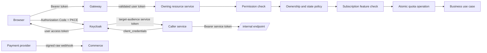

# CINX authentication and authorization specification

Status: **proposed target design**

Applies to: gateway, Keycloak, auth, common-security, all Java resource
servers, recommendation HTTP/SSE and notification WebSocket.

This document is normative for the target implementation. It deliberately
describes a breaking pre-release cutover; current code still has the gaps
listed in the final review.

## 1. Goals and non-goals

### Goals

- One authentication contract for browser, Java APIs, Python APIs and
  WebSocket.
- Additive multi-role assignments with stable fine-grained permissions.
- Permission checks at application boundaries plus ownership/resource-state
  checks in the owning service.
- Explicit service identity for every `/internal/**` operation.
- A clear separation between security permission, subscription feature access
  and quota.
- Durable, auditable role/status changes and Keycloak reconciliation.
- Consistent `401`, `403`, `404`, `409` and `429` behavior.

### Non-goals

- This design does not implement a generic policy-language engine.
- Runtime user-created custom roles are not supported in v1.
- Plan tiers are not security roles.
- The gateway is not the final authorization boundary.
- Network location, RabbitMQ access or an `X-User-Id` header is not proof of
  identity.

## 2. Terminology

| Term | Meaning |
|---|---|
| Authentication | Proves who the caller is and which client issued the request. |
| Role | Human-manageable bundle such as `INSTRUCTOR` or `COMMUNITY_MODERATOR`. |
| Permission | Stable application capability such as `learning.course.update.own`. |
| OAuth scope | Protocol/client consent scope such as `openid`; not a business permission. |
| Relationship | Link between subject and object, for example course owner or session owner. |
| Attribute | Subject, object or environment state used by a policy, for example course status. |
| Entitlement | Feature access granted by a commercial subscription. |
| Quota | Consumable limit attached to a feature entitlement. |
| User token | Access token representing a human user, with `token_kind=user`. |
| Service token | Client-credentials token representing a backend, with `token_kind=service`. |

`ROLE_*`, `PERM_*` and `SCOPE_*` are Spring runtime authority namespaces.
Their prefixes MUST NOT be stored in business tables:

```text
stored role:       INSTRUCTOR
JWT role:          INSTRUCTOR
runtime authority: ROLE_INSTRUCTOR

stored permission:       learning.course.update.own
JWT permission:          learning.course.update.own
runtime authority:       PERM_learning.course.update.own
```

## 3. Source of truth and single-writer rules

| State | Source of truth | Projection/consumer |
|---|---|---|
| Credentials, MFA, login sessions | Keycloak | None |
| Account status | Auth DB | Keycloak enabled state; required bounded denial/version projection |
| User-to-role assignment | Auth DB | Keycloak role mappings |
| Role/permission definitions and composites | Canonical version-controlled authorization catalog | Auth validation and Keycloak realm composites |
| OAuth clients, flows and token mappers | Version-controlled Keycloak realm config | Deployed Keycloak |
| Effective token claims | Keycloak | Gateway and resource services |
| Resource ownership and state | Owning service DB | None |
| Plan/subscription/feature grants | Commerce DB | Local feature projections |
| Quota usage/reservations | Feature-consuming service DB | Reporting metrics only |

Production administrators MUST NOT edit ordinary CINX user role assignments
directly in Keycloak. All grants/revokes, including application break-glass
access, go through auth. `BREAK_GLASS_ADMIN` is a time-bound auth-DB grant with
MFA, alerting and post-use review. A separate Keycloak infrastructure
administrator may repair the identity platform, but MUST NOT create an
ordinary CINX application-role assignment; reconciliation treats such a
mapping as drift.

Auth DB does not need an `account_permission` table in v1. Effective
permissions are derived from version-controlled role composites. Direct
per-user permission grants SHOULD NOT be introduced until a real use case
cannot be represented by a role.

## 4. Authorization decision model

CINX uses a hybrid model:

- RBAC manages role assignment.
- PBAC checks stable `PERM_*` capabilities.
- ReBAC checks ownership and relationships.
- ABAC checks resource and environment attributes.
- Commercial entitlement and quota are independent decision layers.

A role can be an input to commercial purchase eligibility without becoming a
commercial grant. For example, a creator plan requires a pre-existing verified
`INSTRUCTOR` role, but payment never creates that role. Conversely, losing a
plan never revokes `INSTRUCTOR`; only the user/auth partnership workflow can do
that. Every premium instructor operation still requires both its security
permission/relationship and any declared feature/quota.

The normative evaluation order is:

```text
1. Verify signature, issuer, audience, algorithm and exp/nbf.
2. Verify caller type: user, service or provider webhook.
3. Check required PERM_* capability.
4. Check ownership/relationship.
5. Check resource/business attributes.
6. Check active commercial feature entitlement when required.
7. Atomically reserve or consume quota when required.
8. Perform the use case and persist audit/outbox state.
```

Example:

```text
Can update course =
  PERM_learning.course.update.any
  OR (
    PERM_learning.course.update.own
    AND active course membership for principal.uid has role OWNER, MANAGER or EDITOR
    AND course.status in [DRAFT, REJECTED]
  )
```

Example with subscription:

```text
Can use advanced recommendation =
  PERM_recommendation.agent.use
  AND session.userId == principal.uid
  AND feature recommendation.agent.advanced is active
  AND recommendation.agent.requests quota can be reserved
```

## 5. Trust boundaries



Every resource service validates its token again. Gateway validation is
defense in depth and coarse route protection, not delegated authorization.

## 6. Browser authentication

The web client MUST use OpenID Connect Authorization Code with PKCE `S256`:

1. Redirect to the Keycloak authorization endpoint.
2. Use exact registered redirect URIs outside localhost.
3. Bind transaction-specific PKCE, `state` and OIDC `nonce`.
4. Exchange the code directly with Keycloak.
5. Send only the access token to CINX APIs.
6. Keep refresh tokens in the client security boundary; never forward them to
   APIs or place them in URLs/logs.

The confirmed v1 frontend is a pure SPA and `cinx-web` is a public OIDC client:

- it has no client secret;
- access/refresh tokens stay in memory and are not written to URLs, logs or
  persistent browser storage;
- CINX APIs accept bearer access tokens, not an application session cookie;
- API CSRF protection may be disabled only for this stateless bearer-token
  chain; explicit CORS origins remain mandatory;
- logout clears in-memory credentials and invokes the Keycloak end-session
  flow;
- WebSocket authentication follows the STOMP CONNECT/reconnect contract below.

Implicit and Resource Owner Password Credentials flows MUST remain disabled.
The current realm already disables direct access grants for `cinx-web` and
uses PKCE. Production configuration MUST replace wildcard redirect URIs with
exact deployed URIs.

The access-token lifetime is currently 300 seconds. Keep a short lifetime;
refresh-token rotation/reuse detection SHOULD be enabled for deployed clients.

Reference: [OAuth 2.0 Security Best Current Practice, RFC 9700](https://www.rfc-editor.org/rfc/rfc9700.html).

## 7. Identity onboarding

Target v1 uses the Keycloak subject as the initial stable CINX identifier:

```text
uid = Keycloak sub
```

The explicit `uid` claim is retained so services are insulated from a future
identity migration. The flow is:

1. User registers/logs in through Keycloak.
2. The first token can contain only `sub`; converter fallback permits the
   explicitly allowlisted, authenticated onboarding operation only.
3. `POST /api/v1/profiles/me/onboarding` derives identity from the token and
   creates the user profile.
4. User emits a durable `user.profile.onboarded` event.
5. Auth consumes it with a durable inbox, creates the identity account, grants
   `LEARNER`, increments `authorization_version`, updates the Keycloak `uid`
   attribute and role mapping.
6. Auth revokes/refreshes the session so a new token contains `uid`, roles and
   permissions.
7. Instructor application is a separate user-domain workflow. Only a verified
   application adds `INSTRUCTOR`; it does not replace `LEARNER`.

`INSTRUCTOR_APPLICANT` MUST NOT remain an authorization role.
Granting `INSTRUCTOR` only makes instructor-targeted plans eligible. It never
buys or upgrades one. Buying, renewing, canceling or adjusting a subscription
never calls an auth role-grant API and cannot create `INSTRUCTOR`.

If a future implementation needs a CINX-generated ID different from `sub`,
that decision must be made before data is created and an authenticated auth
bootstrap endpoint must allocate it before profile onboarding.

## 8. Keycloak target configuration

### Clients

| Client | Type | Purpose |
|---|---|---|
| `cinx-web` | Public, Authorization Code + PKCE | Browser login |
| `cinx-api` | Resource client | User-facing permission catalog and audience |
| `cinx-auth-admin` | Confidential service account | Restricted Keycloak user administration only |
| `cinx-gateway-service` | Confidential | Gateway revocation-state rehydration only |
| `cinx-auth-service` | Confidential | Auth outbound service calls |
| `cinx-user-service` | Confidential | User outbound service calls |
| `cinx-commerce-service` | Confidential | Commerce outbound service calls |
| `cinx-learning-service` | Confidential | Learning outbound service calls |
| `cinx-notification-service` | Confidential | Notification outbound service calls |
| `cinx-reporting-service` | Confidential | Reporting outbound service calls |
| `cinx-recommendation-service` | Confidential | Recommendation outbound service calls |

Create target-specific internal resource/audiences:

```text
cinx-auth-internal
cinx-user-internal
cinx-commerce-internal
cinx-learning-internal
cinx-notification-internal
cinx-reporting-internal
```

Only create a client/caller mapping when a real call exists. Never reuse one
shared client secret for all services.

Each `cinx-<target>-internal` resource owns its internal permission client
roles. An audience/permission mapper flattens only the service account's roles
for that target into the explicit `permissions` claim. `cinx-web` has no role
scope mapping for internal clients and cannot request an internal audience.

### Roles and permissions

Human-facing application roles are additive composite roles:

| Role | Purpose |
|---|---|
| `LEARNER` | Default user persona |
| `INSTRUCTOR` | Manage own courses and learner submissions |
| `INSTRUCTOR_OPERATIONS` | Review instructor applications and partnerships |
| `CONTENT_REVIEWER` | Review and publish course content |
| `CATALOG_MANAGER` | Manage commercial plans and course subscription policy |
| `COMMUNITY_MODERATOR` | Moderate reports and community content |
| `POLICY_MANAGER` | Manage policy content |
| `PROMOTION_MANAGER` | Manage vouchers and promotions |
| `SUPPORT_AGENT` | Limited cross-user support reads/actions |
| `IDENTITY_ADMIN` | Account status and role administration |
| `FINANCE_OPERATOR` | Reconciliation/refund/finance operations |
| `REPORT_ANALYST` | Reporting reads |
| `NOTIFICATION_OPERATOR` | Send audited platform broadcasts |
| `AI_OPERATOR` | Restricted recommendation support/debug operations |
| `PLATFORM_ADMIN` | Exact composite defined in the authorization catalog |
| `BREAK_GLASS_ADMIN` | Emergency-only, MFA and time-bound |

User-facing permissions are client roles of `cinx-api`. Human roles are
composites of those client roles. Internal permissions are client roles of
the target resource client such as `cinx-auth-internal`; they are never roles
of `cinx-api`.

The canonical catalog MUST be one version-controlled machine-readable file,
for example:

```text
contracts/security/cinx-authorization.yaml
```

It owns `policyVersion`, permission definitions, exact role bundles, target
internal resources and service-account grants. Keycloak realm composites are
generated from or semantically validated against this catalog. Auth loads the
same artifact to validate grants, calculate permission membership and include
the policy version in audit/events. Do not maintain a second hand-written
role-to-permission map in Java.

Target v1 bundles:

```yaml
roles:
  LEARNER:
    permissions:
      - user.profile.read.self
      - user.profile.update.self
      - user.instructor.apply.self
      - commerce.cart.manage.self
      - commerce.wishlist.manage.self
      - commerce.order.create.self
      - commerce.order.read.self
      - commerce.subscription.read.self
      - commerce.subscription.change.self
      - learning.progress.read.self
      - learning.progress.write.self
      - recommendation.agent.use
      - recommendation.session.read.self
      - recommendation.session.write.self
      - notification.read.self
      - notification.update.self

  INSTRUCTOR:
    permissions:
      - learning.course.create
      - learning.course.update.own
      - learning.curriculum.update.own
      - learning.progress.read.own-course
      - learning.submission.grade.own
      - learning.analytics.read.own

  INSTRUCTOR_OPERATIONS:
    permissions:
      - user.instructor.review.any

  CONTENT_REVIEWER:
    permissions:
      - learning.course.review.any
      - learning.course.publish.any

  CATALOG_MANAGER:
    permissions:
      - commerce.plan.manage.any
      - learning.course.subscription-policy.manage.any

  COMMUNITY_MODERATOR:
    permissions:
      - learning.community.moderate.any

  POLICY_MANAGER:
    permissions:
      - user.policy.manage.any
      - user.policy.publish.any

  PROMOTION_MANAGER:
    permissions:
      - commerce.voucher.manage.any

  SUPPORT_AGENT:
    permissions:
      - auth.account.read.any
      - user.profile.read.any
      - commerce.order.read.any
      - recommendation.user.read.any

  IDENTITY_ADMIN:
    permissions:
      - auth.account.read.any
      - auth.account.suspend.any
      - auth.account.reactivate.any
      - auth.role.assign.any

  FINANCE_OPERATOR:
    permissions:
      - commerce.order.read.any
      - commerce.subscription.adjust.any
      - commerce.payment.reconcile.any
      - commerce.refund.manage.any
      - reporting.finance.read

  REPORT_ANALYST:
    permissions:
      - learning.analytics.read.any
      - reporting.dashboard.read

  NOTIFICATION_OPERATOR:
    permissions:
      - notification.broadcast.send.any

  AI_OPERATOR:
    permissions:
      - recommendation.user.read.any
      - recommendation.agent.debug

  PLATFORM_ADMIN:
    includes:
      - INSTRUCTOR_OPERATIONS
      - CONTENT_REVIEWER
      - CATALOG_MANAGER
      - COMMUNITY_MODERATOR
      - POLICY_MANAGER
      - PROMOTION_MANAGER
      - SUPPORT_AGENT
      - IDENTITY_ADMIN
      - FINANCE_OPERATOR
      - REPORT_ANALYST
      - NOTIFICATION_OPERATOR
      - AI_OPERATOR

  BREAK_GLASS_ADMIN:
    includes: [PLATFORM_ADMIN]
    permissions:
      - user.profile.update.any
      - learning.course.update.any
```

Initial service-account grants:

| Target resource | Caller | Permission |
|---|---|---|
| `cinx-auth-internal` | `cinx-notification-service` | `auth.internal.permission-members.read` |
| `cinx-auth-internal` | `cinx-gateway-service`, `cinx-user-service`, `cinx-commerce-service`, `cinx-learning-service`, `cinx-notification-service`, `cinx-reporting-service`, `cinx-recommendation-service` | `auth.internal.authorization-state.read` |
| `cinx-user-internal` | `cinx-learning-service`, `cinx-notification-service` | `user.internal.profile.read` |
| `cinx-commerce-internal` | `cinx-learning-service`, `cinx-recommendation-service` | `commerce.internal.entitlement.read` |
| `cinx-learning-internal` | `cinx-commerce-service`, `cinx-notification-service`, `cinx-recommendation-service` | `learning.internal.course.read` |
| `cinx-learning-internal` | `cinx-notification-service`, `cinx-reporting-service` | `learning.internal.enrollment.read` |

Add a caller only when an active contract and call exist. The authorization
matrix and internal OpenAPI must agree with this table before release.

Role-assignment delegation is also catalog policy:

- `LEARNER` is granted only by the onboarding system command.
- `INSTRUCTOR` is granted/revoked only from a verified user-domain
  partnership workflow.
- `IDENTITY_ADMIN` may grant ordinary staff bundles to another user with MFA,
  reason and audit, but cannot grant to self.
- `PLATFORM_ADMIN` requires two distinct approved actors, at least one current
  platform administrator, and last-admin protection.
- `BREAK_GLASS_ADMIN` requires two-person approval, a maximum 60-minute
  expiry, incident reference, immediate alert and post-use review.
- No human grant flow can grant a service/internal permission.

`auth.role.assign.any` authorizes entry into this policy; it does not mean the
caller may grant every role.

`LEARNER` and `INSTRUCTOR` remain additive; granting `INSTRUCTOR` does not
implicitly remove or replace `LEARNER`. `notification.test.send.any` has no
production human bundle because test endpoints are disabled in production.
Internal permissions have service-account grants in the same catalog and can
never be included by a human role, `PLATFORM_ADMIN` or
`BREAK_GLASS_ADMIN`.

`PLATFORM_ADMIN` MUST NOT imply Keycloak `realm-management`.

The `cinx-auth-admin` service account currently has broad view/query
permissions. Reduce it to user lookup, user attribute update, role mapping,
enable/disable and logout operations actually used by auth.

Keycloak supports realm roles, client roles, composite roles and service
account roles; see the
[Keycloak Server Administration Guide](https://www.keycloak.org/docs/latest/server_admin/).

### MFA

- Email verification is required for normal accounts.
- Staff roles MUST use an MFA-required authentication flow.
- `FINANCE_OPERATOR`, `IDENTITY_ADMIN`, `PLATFORM_ADMIN` and
  `BREAK_GLASS_ADMIN` SHOULD require phishing-resistant WebAuthn when
  operationally possible.
- Break-glass access MUST have alerting, short validity and post-use review.

`mfaRequired: true` in the authorization matrix is a runtime step-up rule, not
documentation only:

```text
acr       = urn:cinx:loa:2
amr       contains an approved MFA method
auth_time is no older than 15 minutes
```

Keycloak emits `acr`, `amr` and `auth_time` in the access token. A shared
authorization component validates the configured ACR, allowed method and
freshness. If the token is valid but insufficient/stale, return
`403 MFA_STEP_UP_REQUIRED`; the SPA starts a fresh OIDC authorization request
with the required `acr_values` and `max_age`. The 15-minute default is
configuration and must be identical across gateway documentation and
resource services. A staff role alone never proves recent MFA.

## 9. Permission catalog

Permission names use:

```text
<service>.<resource>.<action>[.<scope>]
```

Initial catalog:

```text
auth.account.read.any
auth.account.suspend.any
auth.account.reactivate.any
auth.role.assign.any
auth.internal.permission-members.read
auth.internal.authorization-state.read

user.profile.read.self
user.profile.read.any
user.profile.update.self
user.profile.update.any
user.instructor.apply.self
user.instructor.review.any
user.policy.manage.any
user.policy.publish.any
user.internal.profile.read

commerce.cart.manage.self
commerce.wishlist.manage.self
commerce.order.create.self
commerce.order.read.self
commerce.order.read.any
commerce.voucher.manage.any
commerce.plan.manage.any
commerce.subscription.read.self
commerce.subscription.change.self
commerce.subscription.adjust.any
commerce.payment.reconcile.any
commerce.refund.manage.any
commerce.internal.entitlement.read

learning.course.create
learning.course.update.own
learning.course.update.any
learning.curriculum.update.own
learning.course.review.any
learning.course.publish.any
learning.course.subscription-policy.manage.any
learning.progress.read.self
learning.progress.write.self
learning.progress.read.own-course
learning.submission.grade.own
learning.community.moderate.any
learning.analytics.read.own
learning.analytics.read.any
learning.internal.course.read
learning.internal.enrollment.read

recommendation.agent.use
recommendation.session.read.self
recommendation.session.write.self
recommendation.user.read.any
recommendation.agent.debug

notification.read.self
notification.update.self
notification.test.send.any
notification.broadcast.send.any

reporting.dashboard.read
reporting.finance.read
```

The machine-readable operation mapping is in
[`authorization-matrix.yaml`](./authorization-matrix.yaml). Every new
operation MUST be added there before implementation is complete.

## 10. JWT contracts

### User access token

```json
{
  "iss": "https://identity.example/realms/cinx",
  "sub": "keycloak-subject",
  "aud": ["cinx-api"],
  "azp": "cinx-web",
  "token_kind": "user",
  "uid": "cinx-user-id",
  "roles": ["LEARNER", "INSTRUCTOR"],
  "permissions": [
    "learning.course.create",
    "learning.course.update.own"
  ],
  "scope": "openid profile email",
  "authz_ver": 7,
  "authz_policy_ver": 3,
  "acr": "urn:cinx:loa:2",
  "amr": ["pwd", "otp"],
  "auth_time": 1785479100,
  "exp": 1785480000
}
```

### Service token

```json
{
  "iss": "https://identity.example/realms/cinx",
  "sub": "service-account-cinx-notification-service",
  "azp": "cinx-notification-service",
  "aud": ["cinx-auth-internal"],
  "token_kind": "service",
  "permissions": [
    "auth.internal.permission-members.read"
  ],
  "authz_policy_ver": 3,
  "exp": 1785480000
}
```

### Claim rules

- `uid` is `Authentication.name`; fallback to `sub` is accepted only for
  bootstrap compatibility.
- `roles` contains only CINX human/composite role names.
- `permissions` contains effective application permission names without
  prefixes.
- `scope` remains a space-delimited OAuth scope claim.
- `authz_ver` is a monotonic per-user authorization version.
- `authz_policy_ver` identifies the canonical role/permission catalog version.
- `authz_not_after`, when present, is the earliest expiry of an effective
  time-bound role grant. Resource servers reject the token at or after that
  instant even when `exp` is later.
- `acr`, `amr` and `auth_time` support runtime step-up checks.
- A plan claim, if emitted for UI convenience, MUST NOT become an authority or
  the final entitlement decision.
- Permission/role claims belong in the access token. They are not required in
  the ID token.

### Validation

All resource servers MUST validate:

- configured signing algorithm and signature;
- exact issuer;
- required target audience;
- `exp` and `nbf`;
- optional `authz_not_after`;
- `token_kind`;
- caller/client constraints for internal routes.

Public user chains accept `token_kind=user` and `aud=cinx-api`. Internal
chains accept only `token_kind=service` and their target internal audience.
A service token MUST NOT be accepted as a human user merely because it has a
valid Keycloak signature.

Ordinary user operations also require an explicit `uid` claim. The one
allowlisted onboarding operation may accept a first token with `sub` and no
`uid`; converter fallback alone does not authorize any other route.

## 11. `CinxJwtAuthenticationConverter`

`common-security` remains the single owner. Target mapping:

```text
roles[]       -> ROLE_*
permissions[] -> PERM_*
scope         -> SCOPE_*
uid           -> principal
sub           -> bootstrap fallback
```

Implementation requirements:

1. Preserve direct roles and documented realm-role compatibility during the
   cutover.
2. Only admit known CINX roles; do not create `ROLE_offline_access`,
   `ROLE_uma_authorization` or other infrastructure authorities.
3. Parse `permissions` as a collection of nonblank strings matching the
   permission naming pattern.
4. Prefer the explicit `permissions` claim. A configured fallback may read
   `resource_access[expectedResourceClient].roles` only for the resource
   expected by that filter chain: `cinx-api` for user APIs or the exact target
   internal client for service APIs. It MUST NOT merge arbitrary clients.
5. Deduplicate authorities.
6. Never map plan, subscription or feature keys to `GrantedAuthority`.
7. Keep the converter transport-neutral; service-specific policies do not
   belong in `common-security`.

Required tests:

- direct and exact-client roles/permissions;
- `uid` and `sub` fallback;
- malformed, blank and duplicate claims;
- scope never becomes a role/permission;
- infrastructure roles are excluded;
- plan/subscription claims are ignored;
- service token contains permissions but no human role requirement.

## 12. Enforcement in Java and Python

### Gateway

- Deny `/internal/**`.
- Validate user tokens for protected public routes.
- Keep only truly public catalog/policy/identity-provider endpoints
  anonymous.
- Do not rely on gateway routing to authorize a domain operation.

### Java services

Use request-level catch-all authentication and method-level permission checks:

```java
@PreAuthorize("""
    hasAnyAuthority(
        'PERM_learning.course.update.own',
        'PERM_learning.course.update.any'
    )
    """)
public CourseResponse updateCourse(
        String currentUserId,
        String courseId,
        UpdateCourseRequest request
) {
    Course course = courseRepository.findByIdOrThrow(courseId);
    courseAuthorizationPolicy.ensureCanUpdate(currentUserId, course);
    // mutation
}
```

Keep nontrivial ownership/resource-state logic in a policy bean or application
service within the owning service transaction. Avoid long, repository-calling
SpEL expressions. Spring method security supports fine-grained
`hasAuthority` and programmatic policies:
[Spring Method Security](https://docs.spring.io/spring-security/reference/servlet/authorization/method-security.html).

`hasRole('ADMIN')` MUST NOT remain a universal bypass. Staff-any behavior uses
an explicit `.any` permission.

### Recommendation

- JWT is mandatory for protected routes and SSE handshake.
- Validate signature, issuer, audience, time and `token_kind=user`.
- Principal is `uid`, fallback `sub`.
- Session/proposal queries use `(session_id, user_id)`.
- `/users/me` is the normal user API; arbitrary user reads require
  `recommendation.user.read.any`.
- Subscription and quota checks use local projections, not unverified token
  claims.
- Authentication, session ownership, entitlement and quota reservation finish
  before creating the `StreamingResponse`/sending SSE headers. Denials are
  normal HTTP ProblemDetail responses; only failures after dispatch become SSE
  error events and follow quota settlement policy.

## 13. Internal HTTP security

Each service with internal routes needs a higher-priority filter chain:

```text
/internal/**
  require service JWT
  require target internal audience
  require token_kind=service
  require endpoint-specific PERM_*
  deny all unmatched operations
```

The ordinary public chain MUST reject service tokens for user-owned commands.
The internal chain MUST reject browser/user tokens.

Outbound Feign/RestClient calls use OAuth2 client credentials and cache/renew
tokens by client registration. `X-User-Id`, when needed for actor context, is
accepted only after caller service authentication and is never authorization
proof.

User-context calls have a different contract:

- Forward the verified user token only when the target operation is a public
  user operation and the token audience permits it.
- Do not silently replace a user call with an all-powerful service token.
- If both user and service identity are required later, define token exchange
  or an explicit actor-context contract rather than trusting a header.

Example capability lookup:

```text
GET /internal/identity/permissions/{permission}/user-ids

audience:   cinx-auth-internal
token kind: service
permission: auth.internal.permission-members.read
```

Minimal revocation/eligibility rehydration:

```text
GET /internal/identity/accounts/{userId}/authorization-state

audience:   cinx-auth-internal
token kind: service
permission: auth.internal.authorization-state.read
response:   userId, status, roles, authorizationVersion,
            authorizationPolicyVersion, evaluatedAt
```

Callers use this only to restore/verify their bounded local projection. It is
not an endpoint for enumerating users or delegating role management.

## 14. WebSocket authentication and authorization

Notification WebSocket MUST:

- use configured allowed origins, never `"*"`;
- require a bearer token in STOMP `CONNECT`;
- reject missing, invalid or expired tokens;
- use `CinxJwtAuthenticationConverter` so principal equals `uid`;
- permit subscription only to `/user/queue/notifications`;
- deny direct subscription to broker `/queue/**` and `/topic/**`;
- deny arbitrary client `SEND` to broker destinations;
- end with a deny-all message authorization rule.

Do not place access tokens in query strings. If a supported browser client
cannot send secure STOMP CONNECT headers, add an authenticated endpoint that
exchanges a user access token for a short-lived, one-time,
notification-audience WebSocket ticket.

The client reconnects with a fresh credential when the access token expires.
HTTP authentication alone is insufficient because WebSocket messages require
destination-level authorization.

## 15. Provider webhook authentication

Payment/billing callbacks are not user operations:

- They remain anonymous at the user-JWT layer.
- Provider name is allowlisted.
- A provider-specific adapter receives raw bytes and headers.
- Signature, timestamp and replay window are verified before parsing.
- Normalized provider event ID is durably deduplicated.
- Provider object version/timestamp prevents stale out-of-order transitions.
- A browser success redirect never activates an order/subscription.
- Webhook mutation, inbox record and outbox event commit atomically.

Never protect a webhook with `ROLE_ADMIN` or treat knowledge of order ID and
amount as authentication.

## 16. Auth persistence and reconciliation

Target tables:

```text
identity_account
  user_id PK
  keycloak_subject UNIQUE
  email
  status
  sync_status
  authorization_version BIGINT
  created_at
  updated_at
  version

identity_account_role
  user_id FK
  role_code
  granted_by
  granted_at
  expires_at nullable
  status                    ACTIVE | REVOKED | EXPIRED
  revoked_at nullable
  source
  PRIMARY KEY (user_id, role_code)

authorization_audit
  id
  actor_type
  actor_id
  target_user_id
  action
  role_code nullable
  before_json
  after_json
  authorization_policy_version
  request_id
  trace_id
  occurred_at

authorization_grant_request
  id
  target_user_id
  role_code
  status
  requested_by
  approved_by nullable
  reason
  incident_reference nullable
  requested_expires_at nullable
  active_slot nullable       1 while pending, null after terminal
  decided_at nullable
  created_at
  UNIQUE (target_user_id, role_code, active_slot)

keycloak_sync_job
  id
  user_id
  desired_authorization_version
  status
  attempt_count
  next_attempt_at
  last_error_code
  created_at
  updated_at
  UNIQUE (user_id, desired_authorization_version)
```

Two-person `PLATFORM_ADMIN`/`BREAK_GLASS_ADMIN` grants become effective only
when `requested_by != approved_by`, both actors satisfy delegation policy and
the requested expiry is within the catalog maximum. Approval, effective grant,
audit, version increment, sync job and outbox row share one transaction.

Every effective-role calculation, permission-members query and reconciliation
uses the same injected-`Clock` predicate:

```text
status = ACTIVE AND (expires_at IS NULL OR now < expires_at)
```

Therefore a grant is not effective after its deadline even if the materializing
worker is delayed. Index active grants by `expires_at`. A bounded,
`Clock`-driven expiry worker:

1. Claims indexed due grants in bounded batches and locks the affected account
   and grant rows, using skip-locked/equivalent semantics where supported.
2. Rechecks status and deadline under the lock.
3. Changes each still-due `ACTIVE` grant to `EXPIRED`; it never deletes it.
4. Increments `authorization_version` exactly once for the affected user batch.
5. Writes an audit record for every expired grant.
6. Writes the desired Keycloak sync job and full authorization outbox snapshot
   in the same transaction.
7. Uses the high-priority post-commit path to revoke sessions and propagate the
   required denial/version state for privilege expiry.
8. Retries with bounded backoff while preserving the due row and observable
   failure state.

For any token containing a time-bound grant, auth projects the earliest grant
expiry to Keycloak as `authz_not_after`. Gateway and resource servers enforce
it, so a `BREAK_GLASS_ADMIN` token stops working at the exact grant deadline
even if session revocation or the expiry worker is briefly delayed. A refresh
cannot bypass the deadline; until reconciliation removes the expired role, a
new token carries the same expired bound and fails closed.

Do not make a remote Keycloak call the durability boundary of a DB
transaction. A role/status command:

1. Locks the account.
2. Applies idempotent grant/revoke and increments `authorization_version`.
3. Writes audit, Keycloak sync job and
   `auth.authorization.changed` version 2 outbox row in the same transaction.
4. The outbox relay publishes the committed desired authorization state; it
   does not wait for Keycloak.
5. A bounded-retry worker reconciles exact desired roles/status/`uid` to
   Keycloak without touching built-in roles.
6. On privilege reduction, the high-priority sync path revokes sessions.
7. Failed sync jobs remain visible and alertable; a periodic reconciler detects
   direct Keycloak drift.

Admin commands SHOULD return `202 Accepted` with sync status when Keycloak has
not yet converged.

The authorization event represents committed auth-DB truth, not proof that
Keycloak has already converged. Sensitive services use the status/version
denial mechanism described below during that bounded convergence window.

The legacy credential table in auth SHOULD be removed in the next migration;
Keycloak is the only password/OTP owner.

## 17. Authorization event

Routing key:

```text
auth.authorization.changed
```

Header:

```text
eventType: AuthAuthorizationChanged
eventVersion: 2
aggregateType: IdentityAccount
aggregateId: <userId>
```

Payload:

```json
{
  "userId": "user-123",
  "status": "ACTIVE",
  "roles": ["LEARNER", "INSTRUCTOR"],
  "permissions": [
    "learning.course.create",
    "learning.course.update.own"
  ],
  "authorizationVersion": 7,
  "authorizationPolicyVersion": 3,
  "effectiveAt": "2026-07-31T10:00:00Z"
}
```

Consumers use durable inbox processing and apply only a newer
`authorizationVersion`. Notification recipient lookup moves from hard-coded
`ADMIN` to capability-based membership, for example
`learning.course.review.any`; notification preference remains a separate
notification-owned filter.

Commerce is also an authorized consumer of the full status/roles/version
snapshot for plan eligibility. It checks that projection before creating
provider state and again before activating an instructor-targeted plan. The
projection is read-only commercial input: commerce never publishes a role
command or treats payment as identity verification.

When the canonical catalog changes without a user-role change, publishing the
new policy version starts a durable affected-user reconciliation campaign. For
each user whose effective permissions may change, auth locks the account,
recalculates permissions, increments that user's `authorization_version` even
though their role rows did not change, and writes audit, Keycloak sync work and
a full authorization outbox snapshot. Consumers continue to order snapshots by
the per-user `authorizationVersion`; `authorizationPolicyVersion` alone is
never used to bypass that ordering rule.

Permission removal uses the mandatory privilege-reduction path: high-priority
Keycloak reconciliation/session revocation plus the denial/version mechanism.
Catalog publication is not operationally
complete until every affected account has converged or is in an alertable retry
state. Permission-members queries resolve only unexpired roles against the
active catalog version; they do not query Keycloak as a second policy engine.

## 18. Token freshness and revocation

Session revocation does not necessarily invalidate every copied bearer token
immediately. CINX therefore chooses immediate bounded denial for privilege
reduction; waiting for the five-minute JWT expiry is not an authorization
boundary.

This applies to account suspension/ban, role revoke, permission removal caused
by a catalog change, and expiry/revoke of time-bound staff or break-glass
grants. The service objective is denial at gateway/resource boundaries within
five seconds of the committed auth-DB change, with latency measured and alerted.

Required flow:

1. Auth locks/mutates the account or grant and increments the per-user
   `authorization_version`.
2. Audit, high-priority revocation work, Keycloak sync work and the full auth
   outbox snapshot commit atomically.
3. The post-commit path revokes Keycloak sessions.
4. Gateway and protected services consume account status/required version into
   a bounded cache/projection and can rehydrate it through an authenticated
   internal auth endpoint.
5. Reject an inactive account, a token with `authz_ver` below the required
   version, or a token past `authz_not_after`.
6. A protected operation whose required-version state is stale/unavailable
   performs the authenticated version check or fails closed; it never silently
   falls back to token expiry.
7. Permission increases do not invalidate a token; the user refreshes to obtain
   the new permission set.

Required-version cache freshness MUST be at most five seconds for the chosen
SLO. Financial, identity-administration and break-glass operations SHOULD use a
synchronous check when the projection cannot prove freshness. A stale token
returns `401 TOKEN_AUTHORIZATION_STALE`; the SPA refreshes/re-authenticates, and
a fresh token that no longer has the operation permission then receives the
normal `403 PERMISSION_DENIED`.

## 19. HTTP failure semantics

All HTTP failures use `application/problem+json`.

| Situation | Status | Example code |
|---|---:|---|
| Missing, invalid or expired credential | 401 | `UNAUTHORIZED` |
| Token authorization version is stale or account is inactive | 401 | `TOKEN_AUTHORIZATION_STALE` |
| Authenticated but missing permission | 403 | `PERMISSION_DENIED` |
| Valid token but MFA level/freshness is insufficient | 403 | `MFA_STEP_UP_REQUIRED` |
| Missing commercial feature | 403 | `FEATURE_NOT_ENTITLED` |
| Wrong owner where existence may be concealed | 404 | `RESOURCE_NOT_FOUND` |
| Invalid state transition or idempotency fingerprint conflict | 409 | `STATE_CONFLICT` |
| Quota exhausted | 429 | `QUOTA_EXCEEDED` |
| Invalid request | 400 | `VALIDATION_FAILED` |

An OpenAPI annotation never replaces runtime enforcement.

## 20. Audit and observability

High-risk audit fields:

```text
occurredAt
action
decision
reasonCode
actorType
actorId
clientId
targetType
targetId
permission
relationshipResult
featureKey
subscriptionId
quotaOperationId
requestId
traceId
before/after summary
```

Do not store tokens, client secrets, raw webhook bodies or unnecessary PII.
Audit is mandatory for role/status changes, course review/publish/moderation,
plan publication, subscription override/refund, entitlement override, quota
adjustment, reconciliation and break-glass use.

Metrics use bounded labels and MUST NOT use `userId` as a label:

```text
security_authentication_failures_total{service,reason}
security_authorization_denials_total{service,permission,reason}
service_token_rejections_total{service,caller,reason}
authorization_sync_jobs_total{result}
authorization_sync_drift_total{status}
websocket_authentication_failures_total{reason}
webhook_signature_failures_total{provider,reason}
```

Alert on repeated wrong-audience service tokens, Keycloak drift, failed sync
jobs, break-glass access and audit persistence failures.

## 21. Migration and implementation checklist

1. Finish the operation inventory in `authorization-matrix.yaml`.
2. Add the canonical authorization catalog, then generate or semantically
   validate `cinx-api`, exact composite roles, service clients, target
   audiences and token mappers in the realm config.
3. Add a new auth Flyway migration for multi-role, authorization version,
   audit and sync jobs; do not edit applied migrations.
4. Remove `INSTRUCTOR_APPLICANT` from Keycloak roles and move application
   state to user.
5. Replace single-role APIs with idempotent grant/revoke/reconcile operations.
6. Extend `CinxJwtAuthenticationConverter` and all decoder validators.
7. Add service-token filter chains and outbound OAuth2 clients.
8. Replace `hasRole('ADMIN')` and role bypasses with permissions and policy
   checks.
9. Secure Recommendation identity/session ownership.
10. Secure WebSocket CONNECT and destinations.
11. Add the authorization event v2 to AsyncAPI, producer, consumers and tests.
12. Reset/reimport the dev realm and recreate dev DBs after migrations. No
    backward-compatibility adapter is required because there is no release,
    but migration files already applied MUST remain unchanged.

## 22. Required verification

For the current development phase, these behaviors are verified with unit tests,
test fixtures and mocked/fake Keycloak/service adapters. Live Keycloak,
Testcontainers and end-to-end integration verification are deferred until the
project-stabilization phase and are not a current PR gate.

### Token and converter

- Valid user token yields expected `ROLE_*`, `PERM_*`, `SCOPE_*` and principal.
- Wrong issuer/audience/algorithm, expired and not-yet-valid tokens fail.
- User token fails internal chain; service token fails user chain.
- Infrastructure roles and plan claims do not become authorities.

### Endpoint matrix

For every protected operation:

```text
no token                     -> 401
valid token, no permission   -> 403
own permission, wrong owner  -> 403 or concealed 404
own permission, owner        -> success
any permission               -> success
wrong resource state         -> documented denial
```

### Keycloak behavior

- PKCE and exact production redirect URI.
- Direct grant and implicit grant disabled.
- Composite roles emit exact permission claims.
- Service account emits only target-specific permissions/audience.
- Auth reconciliation converges after transient Keycloak failure.
- Privilege reduction revokes sessions.
- Direct Keycloak drift is detected.

### Internal and WebSocket

- Human token cannot call `/internal/**`.
- Wrong caller, audience or service permission fails.
- Missing/invalid WebSocket CONNECT fails.
- Foreign origin and unauthorized SEND/SUBSCRIBE fail.
- Only the authenticated user's notification queue is visible.

## 23. Confirmed and remaining decisions

Confirmed for v1:

- frontend is a pure SPA using Authorization Code + PKCE and bearer access
  tokens;
- privilege reduction uses the immediate required-version/status denial design
  with a five-second service objective;
- learner/instructor plan segmentation is purchase eligibility only and cannot
  grant an authorization role.

The remaining authorization decision is whether role/permission bundles remain
config-as-code. This specification assumes they do. A runtime custom-role
builder requires moving definitions/mappings into auth DB and is outside v1.
